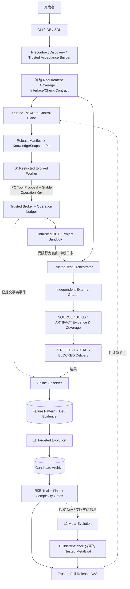
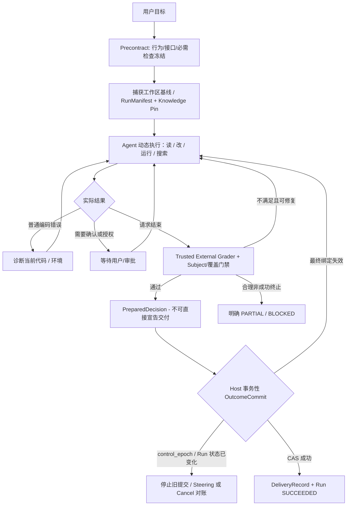
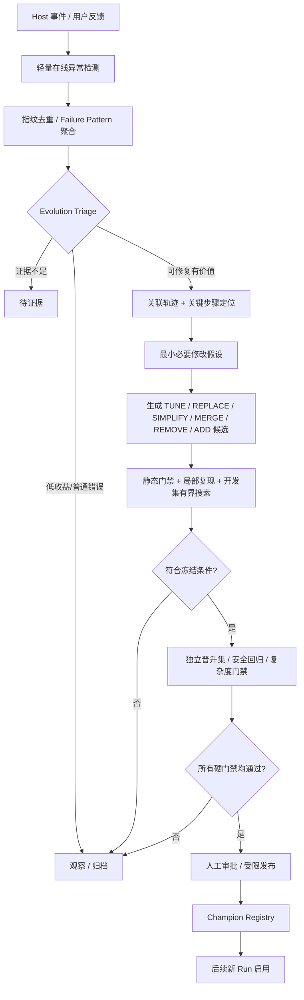

# repo-code v1.5｜业务与总体架构设计

> **文档状态**：`DESIGN_REVIEW_V1.5`（设计评审稿；未开发、未部署、未做性能评测）  
> **文档版本**：v1.5 · 2026-10-30  
> **适用产品**：独立本地优先 Coding Agent（与项目学习 Agent、CareerForge 完全独立）  
> **配套文档**：[02｜RSI 与技术实现设计](02_repo-code_RSI_Technical_Design.md)  
> **v1.2 继承设计**：引入问题驱动的 **Targeted Evolution**、在线/离线双速处理、**Meta-Evolution**、**Complexity Governor**、替换/简化/淘汰优先的候选操作，以及探索空间与生产空间隔离。

---

## 0. 一页摘要与产品定位

**repo-code 是一款真正执行软件开发任务的 Coding Agent**：在用户授权的工作区创建或修改代码、运行程序与测试、根据错误反馈调试、接受中途纠正，并交付可审查的 Diff、运行证据和风险说明。

它必须首先解决**真实任务完成率、开发者控制感和安全交付**，不能让自进化系统取代基本编码能力。代码理解只是辅助完成修改与调试的工具，不是教学产品；不设计课程、学习计划或求职功能。

与普通 Coding Agent 的拟议差异是：利用真实编码轨迹构建**证据驱动的、定向的、复杂度受约束的递归自我改进（RSI）**。RSI 优化的是 repo-code 未来执行编程任务的方法，不是当前用户提交的业务代码。

**三层角色：**

| 层次 | 要完成的工作 | 实际修改对象 | 是否位于用户任务关键路径 |
|---|---|---|---|
| **L0 · Coding Runtime** | 完成用户的创建、编辑、执行、修复、测试和交付 | **用户项目**与其任务工作区 | **是** |
| **L1 · Targeted Evolution** | 从执行证据中识别可修复的 Harness 弱点，定向优化 | repo-code 的可进化策略、Skills、工具接口及授权的非安全实现 | **否**；独立评测 |
| **L2 · Meta-Evolution** | 改进 L1 寻找有效修复的方式 | L1 的参数、算法、搜索策略、内部模块与经授权的内部拓扑 | **否**；更严格的独立评测 |
| **Trusted Governance（不是 L3）** | 提供安全、版本、复杂度、验收、评测与发布最终约束 | 可信控制规则由人类维护 | 所有执行和发布必须遵守 |

**v1.3 继承的设计评审约束**：一个 Run 固定任务规格/验收契约；整份 ReleaseManifest 原子晋升；获批进化代码仍受限运行；隐藏评测与学习数据隔离；紧急安全控制抢占任务。

**v1.4 第二轮审查修复**：关键行为验收改为**外部可信裁判**（同进程 pytest 不单独构成可信通过）；Broker 采用稳定 Operation Key 和持久化去重；验收拆分 `SOURCE/BUILD/ARTIFACT` 证据链；Knowledge Snapshot 按 Run/Trial 固定但独立于软件 Release；Meta Builder 与冻结评测实例分身份；Greenfield 先建立可观察行为/接口和受保护检查再进入正式编码 Run。

**v1.5 第三轮审查修复**：`required_checks` 全集与需求覆盖分开校验，未挂在 CoverageMatrix 的全局必需检查也必须通过；验收评测只生成 PreparedDecision，Steering/Cancel 接纳与最终 `DeliveryRecord` 提交由可信控制面单一事务顺序裁决，确保不存在旧目标的竞态成功交付。

**最终目标：** Agent 能够不断**替换、合并、简化、淘汰**旧机制，并仅在有证据证明必要时新增机制；最终运行版本保持紧凑、可维护、可审计。

---

## 1. 设计原则与硬性产品边界

1. **先交付，后进化**：日常编程中发生的普通语法/业务 Bug，由 L0 即时修复；不得因每次失败都等待 RSI 完整闭环。
2. **症状不等于根因**：Tool 抛错不代表 Tool 本身应修改。深度分析只针对与失败有因果关联的最小路径，证据不足允许 `INCONCLUSIVE`。
3. **定向而非轮询组件**：不逐一遍历 Memory、Context、Planning、Tools、Skills 等所有组件进行候选搜索；仅对被证据支持的修复位置发起受控实验。
4. **可信事实高于模型解释**：文件实际状态、进程退出码、审批、验收、评测结果由 Host 持有；模型归因只作为待检验假设。
5. **演化必须可拒绝**：能生成候选但无法证明改进，只能记为候选实验，不能宣称自我提升。
6. **默认减法进化**：优先 `TUNE / REPLACE / SIMPLIFY / MERGE / REMOVE`；`ADD` 必须说明现有结构为何不足。
7. **复杂度是发布约束**：新增模块、依赖、上下文、运行耗时和知识检索噪声都计入成本，不允许为了刷分无限增加系统规模。
8. **不允许自改裁判**：安全执行、独立评测、隐藏测试、发布授权、审计和 Complexity Governor 不得由进化候选修改。
9. **探索与生产分离**：Evolution Space 可以保存受限数量的研究候选；Production Space 只加载经批准的当前有效组件。
10. **不新增 L3**：L2 可多次改进自身内部版本，但不得递归生成新的元元 Agent 管理层。
11. **验收语义不可漂移**：TaskSpec/Contract 一旦随 Run 固定，改变业务目标的 steering 必须新建 successor Run。
12. **只有最终产物经过指定验证才算通过**：检查与代码/测试定义/收集范围/环境/最终快照绑定，不能用弱化测试刷成功。
13. **发布的是完整版本组合**：只有实际被评测的 ReleaseManifest 能激活，不把已测的单项配置临时拼装上线。
14. **批准不等于提权**：获准部署的可进化模块仍在隔离执行域，通过 Trusted Broker 获得有限能力。
15. **隐私与评测隔离**：隐藏测试逐项报告不回流学习器，暴露信号会标记后代污染并要求新独立样本。
16. **安全控制抢占任务**：撤销/终止/隔离具有独立、可测响应路径，不能排在普通 Coding Run 后面。

17. **隔离的是裁判执行权，不只是测试文件**：被测代码和它的同进程 pytest/插件都属于可能受干预的执行域；关键验收必须由 OS 权限隔离的可信外部 Grader 判断。
18. **Broker 操作恢复先查再做**：稳定 Operation Key + 参数摘要 + Ledger 去重；重连不能以新请求重做不确定副作用。
19. **验证结果按检查对象组合**：SOURCE 证据不必拥有构建产物，交付可执行物需由独立 BUILD 与 ARTIFACT 证据建立链路。
20. **知识快照不等于 Release**：Run/Trial 固定 Knowledge Snapshot，长期记忆改变不悄悄改变本 Run；个人/项目 Memory 不需每次软件发布。
21. **Meta-Eval 明确身份隔离**：构建候选优化器者看不到隐藏题；被测冻结实例仅取得分配给它的当前题公开部分。
22. **Greenfield 先建立验收**：从目标建立可观察行为、接口和必需检查，覆盖不足不得 VERIFIED。
23. **必需检查不得漏验**：无论是否关联某一条需求，所有受保护 `required_checks` 必须在冻结时注册，并在交付时独立验证；CoverageMatrix 只用于需求覆盖判定。
24. **提交成功必须有事务线性化点**：已接纳的 Steering/Cancel 立刻提升可信控制版本并阻断旧验收提交；`DeliveryRecord` 与 Run 终态在同一持久事务提交。

### 1.1 明确不做

- 不将产品建设为项目学习/项目讲解系统；不与 CareerForge 共享学习业务流程。
- 不把“接入 MCP”“拥有 N 个子 Agent”当作独立任务完成指标。
- 首版不做云端多租户、组织权限、任意外部写入自动重试、未经授权的代码自动推送/合并。
- 首版不做闭源模型权重在线更新；模型-Harness 联合训练属于后续独立研究。
- 不承诺自动发现所有根因、每次 RSI 都变强、任意 Shell/外部 MCP 副作用 exactly-once，也不承诺黑盒测试可证明任意未测试输入的程序正确性。

---

## 2. 用户与核心业务场景

| 场景 | 用户输入示例 | 必须真实交付 |
|---|---|---|
| Greenfield / 从零开发 | “构建一个有配置、日志、测试的 CLI 工具。” | 冻结的行为/接口验收契约、真实工程、可运行入口、可信检查结果与覆盖缺口 |
| Feature / 功能开发 | “为 FastAPI 增加幂等批量导入接口。” | Diff、相关功能测试与已有回归 |
| Debug / 故障修复 | “根据失败日志复现并修复这个异步 Bug。” | 原因证据、补丁、修复后验证 |
| Refactor / 受控重构 | “换底层缓存实现，保持公开接口。” | 兼容性证据、变更说明、回归 |
| Maintenance / 维护 | “修复依赖和构建失败。” | 实际构建结果、配置变化、风险 |
| Long-running collaboration | “先写功能，期间不要增加依赖。” | 中途约束真实生效、可暂停恢复、诚实交付 |

**辅助能力**：代码检索、AST/LSP/符号导航、上下文召回、MCP、按需子 Agent。只有当它们帮助完成编码任务时，才进入主业务流程。

**首期目标用户与平台**：本地单用户；Python 3.11+ 工程为优先验收范围；Windows/Linux 受信任本地环境先运行，强隔离环境专项逐步补齐。CLI 优先，IDE/Web 以后复用同一内核。

---

### 2.1 Greenfield 验收启动流程（v1.4）

对于空仓库的创建任务，**正式编码前要先确定什么叫完成**。系统设立低成本的、只读的 `PRECONTRACT_DISCOVERY`：用户目标 → 功能/安全/失败语义 → 对外可观察行为与 CLI/API/HTTP 接口 → Requirement Coverage Matrix → 由独立验收设计者生成初版检查 → 可信 Host/授权审查者冻结。

- **初始接口尚不确定**：先确定外部行为和必要接口约束，不依赖某个内部函数实现；必要的关键歧义才请用户决策。可以开始 `EXPLORATION_ONLY` 原型，但不能以空测试集宣告 VERIFIED。
- **谁建立检查**：可信验收设计流程可借助 LLM 提议，检查由 Host/授权审查者注册为 `ProtectedRequiredCheckBundle`；实现 Agent 自己编写的测试只能补充，不能取代必需验收。
- **何时冻结**：在具有可执行行为检查、接口一致性约定和必需需求覆盖关系之后，契约状态 `DRAFT → REVIEWABLE → FROZEN`，此时才启动有资格进入 `VERIFIED` 的正式 Coding Run。
- **v1.5 冻结双重校验**：检查 `required_checks` 注册全集，确保每项必需检查关联必需需求或显式属于 `global_required_checks`（如全局 lint、安全扫描），覆盖矩阵引用的检查均有受保护定义；不能因为全局检查没有归属某条需求就漏掉执行。
- **缺少可验证 oracle**：如需人工判断，明确安排 `HUMAN_ACCEPTANCE`；未完成、检查不足或没有关键负例时返回 `outcome=PARTIAL, verification_reason=INSUFFICIENT_EVIDENCE`；需求变化则重新冻结 Contract 并开启 successor Run。

例：要做 FastAPI JWT 登录，验收不应仅是“服务能启动”；至少要事先定义成功登录和非法凭据/伪造 token 拒绝的外部响应检查。

## 3. 产品功能架构



### 3.1 业务能力域

| 域 | 功能与对用户可见的价值 | 产物 |
|---|---|---|
| Task & Interaction | 创建任务、Steering、审批、暂停/恢复、状态查询 | Task/Run、用户约束、指令生效事件 |
| Coding Execution | 代码创建、编辑、运行、构建、调试 | 实际文件变化、工具/进程结果 |
| Context & Memory | 任务续接、历史回取、项目约定、Skill 调用 | 上下文投影、来源证据、Skill 版本 |
| Collaboration | 按需只读探索、隔离测试与有限子任务 | 子任务报告、候选补丁 |
| Verification & Delivery | Greenfield 验收建立、可信外部裁判、SOURCE/BUILD/ARTIFACT 证据组合 | CoverageMatrix、InterfaceContract、VerificationEvidence、Diff、Artifacts |
| Broker Reliability | 稳定 Operation 身份、同键去重、断线查询与未知副作用对账 | OperationLedger、Result/UNCERTAIN、审计 |
| Knowledge Pinning | 项目/个人知识版本化；Run/Trial 绑定快照与检索索引 | KnowledgeSnapshotManifest、KnowledgeIndex Digest |
| Evidence & Observation | 跨 Run 记录事实、识别异常症状 | 原始轨迹、问题记录、异常指纹 |
| L1 Targeted Evolution | 找到值得改进的机制，提出针对性候选 | FailurePattern、Candidate、局部/全局报告 |
| L2 Meta-Evolution | 提升 L1 搜索有效性和预算利用率 | MetaCandidate、MetaExperiment、版本决策 |
| Trusted Governance | 安全/复杂度/评测发布门禁 | 不可自修改的判定、Registry 版本 |

---

## 4. 两条独立的主业务闭环

### 4.1 Loop A：实时 Coding Task Self-Correction



在正式 L0 构建前，必须有经审查的 `FROZEN` 验收契约；没有足够检查的探索 Run 可以生成原型，但不得宣称完整 VERIFIED。正常任务计算资源优先于离线演化，但**紧急安全控制拥有独立抢占通道**。Agent 只能使用已发布的整份 Release，不能在进行中的 Run 热切换未验证组件。`Agent self-correction ≠ Harness self-evolution`。

**Steering 转换示意**：

```text
执行偏好（仅调整顺序/显示/更保守的操作）→ 同 Run 安全点应用执行指令
新增权限检查/删除需求/缩减允许变更范围 → 旧 Run 停止新增副作用并对账
                                                    ↓
                                  新 TaskSpec + 新 Contract + successor Run
                                                    ↓
                              继承稳定文件快照，重新取得验收证据
```

如果 Host 无法确认某条 steering 是否影响契约，必须要求确认或按目标变化处理；不可沿用旧 Contract 宣告 `VERIFIED`。

**v1.5 顺序规则**：用户指令进入网络接口不代表已经被接受。可信 Host 先在控制数据库事务中记录 `ControlInboxEvent`、提升 `control_epoch` 并建立完成栅栏，才向用户确认接纳；即使尚未分类，最终交付也必须等待处理。长时间运行的验收协程只生成 `PreparedDecision`，之后以最新 Run 状态、控制版本、取消标记和封存快照为条件原子提交 `DeliveryRecord`。**如果 Steering/Cancel 先提交接纳事务，旧成功被拒；如果旧成功先提交，历史记录仍有效，新需求开启后续版本。** 参见技术 §4.3.2。

### 4.2 Loop B：离线 Evidence-Grounded Targeted RSI



**在线路径只做事实记录、轻量规则和可有界写入的去重。** 深度因果定位、LLM 候选搜索、端到端评测与晋升在独立 worker 中执行，不要求当前用户等待。具体排程需由实际 Runtime 实现；本文是目标架构，不表示已有自动后台服务。

### 4.3 第三条：经验证的成功经验 → 可复用 Skill

成功任务也可能带来价值，但不能与“发现 Harness 缺陷”混为一谈：

`成功轨迹/用户明确反馈 → 带来源经验 → 检索相似已存 Skill → 新建/替换/合并/归档候选 → 正负例与独立任务评测 → 经批准成为 Skill 版本`。

这条路线不要求每次都进入完整 Harness Code Evolution；存储一条偏好也不等于已验证自进化。Skill 的热加载不应自动扩大工具权限。

---

## 5. L0 / L1 / L2 的业务责任与资源边界

### 5.1 L0：完成当前任务

- 真实动作：创建、读取、搜索、精确修改、运行、诊断、验证、交付。
- 关键约束：Agent 不能自己扩大权限、声明不存在的执行结果、降低 Host 的验收标准。
- 用户中途 steering **先分类**：不改变目标/范围/验收的执行偏好可在同 Run 安全点生效、记录 `ExecutionDirectiveRevision` 并重验旧提案；**新增/取消需求、改变修改范围和验收条件必须创建新 `TaskSpecRevision + AcceptanceContractRevision` 并启动 successor Run**。
- 新 Run 仅继承旧 Run 对账后确认的工作区文件状态，**不继承旧审批和验证证据**；旧 Run 在安全结算后标记 `SUPERSEDED`，不确定副作用不能绕过对账。
- **知识可重现**：Run/Trial 固定 `KnowledgeSnapshotManifest` 与相应检索索引；新长期记忆从后续新 Run 生效，强制刷新需要合法 successor。
- **工具恢复**：Worker 重连先查询 Broker 已登记的稳定 Operation；同键不同参拒绝，效果未知不能重复执行。
- **交付与控制竞争**：最终成功必须等待 `OutcomeCommit` 事务成立，禁止在 Grader 通过后直接显示 VERIFIED。未分类 Steering、Cancel 或旧 Writer epoch 均会使过期的 PreparedDecision 失效；事件序号记录可审计先后关系。
- 输出：交付状态、Diff、可回取的执行证据、明确的未完成项；每份交付记录绑定 `TaskSpecRevision / ContractDigest / final snapshot / ReleaseManifest / KnowledgeSnapshot`。

### 5.2 L1：改善未来的 Coding Agent

- 输入：可信运行事件、失败模式、通过/失败的测试、用户反馈、组件版本和历史候选效果。
- 只处理**有问题证据的最小因果路径**，不每轮遍历全部 Harness 组件。
- 可以修改：Memory、Context、Planning、非权限 Tool ACI、Skills、Delegation、白名单内非安全 Harness 实现。
- 不自动改：权限、Sandbox 强制边界、审计事实、独立评测器、Champion 发布权限、Complexity Governor。
- 输出：明确目标的候选、复现验证、跨任务效果、成本与回归报告；通过门禁后只通过**整份 ReleaseManifest** 原子发布，不允许独立组件 CAS。

### 5.3 L2：改善 L1 的优化方法

可以对 L1 做三个风险等级的修改：

| 等级 | 例子 | 审核方式 |
|---|---|---|
| **M-A 参数与策略** | Pattern 优先级、候选生成数量、搜索权重、实验选择策略 | 独立 Meta-Eval；受限配置可经预授权发布 |
| **M-B 算法与实现** | 规则+LLM 混合归因、候选去重/选择、预算分配算法 | 版本化代码、独立测试、审批 |
| **M-C 内部拓扑与模块重构** | 把单体 FailureAnalyzer 重构为 EvidenceExtractor+Localizer+HypothesisGenerator | 全量契约/安全/性能回归 + **人工批准** |

L2 在 S6 的完整嵌套搜索评测协议冻结之前保持**自修改关闭**；之后可按版本迭代自身的**允许变化的搜索策略**，但**不生成新进化层级，不改可信裁判**。外部接口/Schema 的破坏性变化视为可信契约迁移，不能由普通元候选自动发布。

### 5.4 Trusted Governance：不可成为候选的“裁判”

负责权限与隔离规则、**可独立判定的验收外部 Grader**、受保护检查注册、Broker Operation Ledger/对账、Knowledge Snapshot 权限、隐藏评测、GatePolicy、整份 ReleaseManifest 原子发布、审计存储、独立安全抢占通道以及 Complexity Governor。可信控制面**可以经人工工程变更升级**，但 L1/L2 都没有自动改写权。尤其不能通过缩减测试、删除失败记录、提高资源限额的方式“证明进步”。

---

## 6. 什么问题应触发 RSI？

不要做“有异常 → 立刻生成进化候选”的自动化。建议由在线低成本检测、问题聚合和离线价值判断三个阶段分担成本。

| 现象 | L0 实时处理 | L1 处理 |
|---|---|---|
| 第一次 pytest 失败 | 分析并修复当前项目 | 只记录事实，不自动启动 |
| 重复相同失败命令，相关状态未变化 | 要求模型获取新证据或停止无效操作 | 聚合 `ineffective_retry`，具备价值时启动 |
| 历史 Context 的用户限制遗失 | 按权威任务约束阻断旧提案 | 诊断 Context 投影/压缩策略 |
| Tool 返回模糊错误，反复引发误用 | 尝试安全恢复当前任务 | 定向提出 Tool Error ACI 候选 |
| 频繁召回失效 Skill | 失效过滤、必要时忽略 Skill | 优化检索/效用/适用范围 |
| 只有一次偶发网络/环境失败 | 有界重试或报告环境问题 | 观察；不把环境缺陷当 Agent 退化 |
| 代码或脚本有越权危险 | **立即拒绝/停止** | 走独立可信安全流程，不自动放宽权限 |
| 任务成功但多次浪费工具调用 | 仍正常交付 | 可产生成本优化 Pattern |
| 经过验证的成功经验可复用 | 正常交付 | 产生受限 Skill/Memory 候选 |

`EvolutionTriage` 不采用固定“失败三次就进化”的全局阈值；应综合严重程度、跨任务影响、可复现性、可修复性、成本和潜在回归。**诊断失败允许 `INCONCLUSIVE`，而非强行选一个组件。**

---

## 7. 以真实任务驱动的端到端例子

**任务：** 为 FastAPI 项目加入 JWT 认证与测试。

1. **L0 正常编码**：生成文件、运行 `pytest`，得到 `ModuleNotFoundError`；第一次失败属于正常调试，Agent 应尝试修复依赖/配置。
2. **Online Observer 轻量记录**：若在仓库/依赖/环境无相关变化、没有新证据时连续重复相同失败命令，记录症状 `ineffective_retry`。当前任务不等待 RSI。
3. **Pattern Registry 合并**：来自多个任务的类似无效重试被聚合，注明语言、错误类型、相关状态和证据引用；不能仅凭同一个错误字符串合并不同根因。
4. **Triage**：判断是否可复现且影响多个任务，是否值得投入进化预算。无证据则继续观察。
5. **L1 定向候选**：诊断旧策略在确定性失败后无新证据重试，优先产生已有 `RetryPolicy` 的 `REPLACE/SIMPLIFY` 候选，而不是新增三个 Retry 子 Agent。
6. **逐级验证**：候选必须修复来源问题、支持正常暂时性故障重试、不破坏其他编码任务，在独立任务集有可重复收益，且未超复杂度预算。
7. **发布**：批准后，新 Run 加载 `RetryPolicy v2`；现有 Run 不热切换。历史版本和失败候选按保留规则存档，不加载进生产运行时。
8. **L2 元进化**：若多轮 L1 实验发现 FailureLocalizer 总把 Tool ACI 弱点错归因于 Prompt，可生成 L1 Localizer 的内部重构候选，在未见过的优化问题上以同等预算对照 V1/V2，再经可信门禁决定是否发布。

**成功标准**：不是多出了一个 `RetryAgent`，而是用更少无效调用、更好的任务结果和受控的复杂度证明相应改进；若独立评测不能证明收益，则本次进化应被拒绝。

---

## 8. Complexity-Constrained Evolution（复杂度约束）

### 8.1 六类进化操作，而不是只允许新增

| 操作 | 何时适合 | 评价要点 |
|---|---|---|
| `TUNE` | 已知机制有效，仅参数或规则偏离 | 是否降低错误与资源开销 |
| `REPLACE` | 旧实现存在可定位缺陷 | 新旧版本对照，旧机制退出活跃路径 |
| `SIMPLIFY` | 条件、分支、模型轮次过多 | 不牺牲质量前提下降低复杂度 |
| `MERGE` | 重复规则、重复 Skill、重叠模块 | 合并后是否仍覆盖原适用条件 |
| `REMOVE` | 证据表明无效/有害/被替代 | 不破坏历史任务和必要安全边界 |
| `ADD` | 现有结构无法合理解决问题 | **需要新增必要性证明**与受控增长预算 |

这是默认偏好，不是强制依次遍历六个选项。Level 2 可以直接提出证据充分的架构级替换。

### 8.2 复杂度预算必须覆盖的方面

- **代码结构**：活跃模块、公开接口、依赖边、分支/圈复杂度、重复逻辑。
- **执行拓扑**：主/子 Agent 层级、平均额外模型调用与 Tool Call、流程节点和状态转换。
- **上下文体积**：System Prompt、工具 Schema、Skills/Memory 的默认注入 token。
- **知识噪声**：活跃 Skills/Memory 数量、误触发、重复与过期条目占比。
- **运行成本**：主任务延迟、尾延迟、调用费用、CPU/内存/存储开销。
- **搜索复杂度**：候选数、分支数、评测次数、单 Pattern 演化预算。

**不能仅用代码行数**评价复杂度：新增 100 行替换 500 行重复实现可能是净简化；20 行 Prompt 使每个请求多消耗几千 token 也可能是净膨胀。

### 8.3 Trusted Complexity Governor

Governor 是**确定性可信控制器**，不是额外的 LLM Agent；它读取候选前后复杂度向量、成本与回归结果，在发布前核对事先冻结的预算和新增必要性。

- 默认先比较是否存在 `REPLACE/MERGE/SIMPLIFY/REMOVE` 的合理方案。
- 超出硬预算的候选不能自动发布；改变预算必须有独立人工配置评审，不能由候选顺便修改。
- 即使复杂度下降，也必须通过质量与安全评测，不能因“更短”就直接接受。
- 复杂度增长但收益明显的候选可以在已批准预算内通过，**不是必须越改越小**。
- 检测“复杂度迁移”（从代码转移到 Prompt、配置或额外 Agent）和通过删除测试/注释刷指标的行为。

### 8.4 Production Space 与 Evolution Space

| 空间 | 内容 | 运行限制 |
|---|---|---|
| **Production** | 单个部署作用域激活的一份完整 ReleaseManifest + 依赖及有限回滚点 | 不加载候选树、旧 Skill 或实验日志到模型上下文 |
| **Evolution** | 有界 Candidate DAG、失败试验、支撑证据、实验报告 | 独立工作区/预算/访问权限，不能改生产版本指针 |
| **Protected Archive** | 被引用的历史版本、审计和未解决恢复材料 | 保留策略管理；不得因容量不足强删未解决事实 |

知识条目生命周期：`CANDIDATE → ACTIVE → DEPRECATED → ARCHIVED → PURGE_ELIGIBLE`。低使用率不直接等于可删除，特别是重要但低频的安全经验。

### 8.5 递归与搜索停止条件

- 固定 L0/L1/L2 三层，不新增 Level 3；允许 L2 对其**自身可进化策略的版本**多轮改进。
- 同一 Failure Pattern 默认只有一个活跃实验；候选数、深度、评测次数和资金预算都有上限。
- 连续未产生有效收益时冷却/归档，不能无限重试；进化不占用 L0 正常编码任务的资源保障。
- **S4 首次候选晋升前**必须部署最小可信 Complexity 硬预算门禁；S5 再增加高级重复识别、简化与淘汰。
- 发布前必须通过 Complexity + Security + Regression + Quality + 冻结后的 **Final Holdout（G4b）**；未见样本不足则暂停自动发布。

---

## 9. 用户界面与可观察结果

第一版主要通过 CLI，后续 IDE/Web 使用相同 Task API。

| 用户动作 | 预期显示 |
|---|---|
| `task new` / `run` | 当前目标、工作区、预算、Harness 版本 |
| `steer` / `pause` / `resume` | 显示执行偏好或契约变更、successor Run、继承快照与失效审批；可查询原 Operation 的未决状态 |
| `inspect` / `diff` | 实际变更和待提交提案 |
| `report` | 显示交付绑定的 Task/Contract/Release/Knowledge、SOURCE/BUILD/ARTIFACT 证据、可信度、覆盖不足与实际失败，不将 DUT 自述当独立判定 |
| `evolution status` | 发现的 Failure Patterns、待实验问题、资源预算 |
| `evolution candidates` | 候选类型、修改范围、开发集结果、复杂度变化 |
| `evolution report` | 默认展示来源与 Dev 证据和受限发布结论；隐藏集逐题数据仅授权审查者可见 |
| `evolution approve/rollback` | 对**整份 ReleaseManifest** 激活/回滚；并发 CAS 失败要求重新组合与评测 |

这些是待实现的**产品交互语义**，命令拼写不是已发布的 CLI。

---

## 10. 成功定义、验收与可展示指标

### 10.1 开发任务本身

交付包必须包含：目标和范围、实际文件 Diff、运行过的测试和命令、执行退出状态、未运行检查、已知风险、使用的模型与 Harness 版本、原始证据的受权引用。

- `ANSWERED`：只读问题有证据地回答，未必修改文件。
- `VERIFIED`：**所有已注册必需检查独立通过，且每条强制需求覆盖充分，最终成功事务提交已完成**；正式 Contract 已冻结、必需需求覆盖足够，且经可信外部裁判或适用的授权人工判定提供充分证据；`SOURCE` 证据绑定最终源码，交付可执行物时 `BUILD` 证明源码到工件的关系、`ARTIFACT` 检查实际工件。**不要求 SOURCE 单测绑定不存在的 wheel**；同进程 `pytest`/插件可受 DUT 篡改，只提供限定可信度的补充证据。每份报告必须说明哪些需求被可信验证、哪些只被自测、哪些仍无覆盖；测试后相关修改会使相应证据失效。
- `PARTIAL / BLOCKED / FAILED / CANCELLED`：不伪造成功或省略负面结果。

### 10.2 RSI 与 Meta-Evolution

| 指标 | 含义 | 容易出现的统计错误 |
|---|---|---|
| Verified Success | 真实任务的 Host 验收结果 | 用模型自述“完成”替代 |
| Fail→Pass / Pass→Fail | 同一任务的成对结果翻转 | 只公布改善，不公布回归 |
| Net Quality Gain | 独立任务上的质量净变化和不确定度 | 用来源任务 Replay 冒充泛化 |
| Hot-path Overhead | Observer 对正常任务增加的延迟/资源占用 | 将异步排队写入称为零成本 |
| Cost per Accepted Improvement | 获得一个晋升版本所耗全部搜索/评测成本 | 只统计候选最后一次调用 |
| Complexity Delta | 当前生产复杂度向量变化 | 只看 Python LOC，忽略 Prompt/依赖/额外模型轮次 |
| Meta Search Efficiency | 相同预算下新旧优化器**完整嵌套 L1 搜索**的有效候选发现率及全部失败/成功成本 | 只比较一次候选或仅汇报成功例 |
| Holdout Exposure | 区分 Dev、晋升、最终隐藏评测访问；学习血缘中记录样本信息曝光 | 将晋升逐题失败/测试 ID 回流给优化器后仍宣称独立 |

全部指标在真实任务完成之前是**计划中的测量口径**，不能预填“提升 30%”或类似结果。

---

## 11. 分阶段建设路线与每阶段退出条件（v1.4 修订）

| 阶段 | 本阶段真正完成什么 | 必须通过的退出验收 |
|---|---|---|
| S0：最小编码链 | CLI、主 AgentLoop、可信 ToolGateway、Broker Operation Ledger/IPC、事件事实与 Emergency 基础通道，验收草案模式 | 能创建运行程序、断线同键查回原操作；没有正式验收时只报告探索结果，不伪造 VERIFIED |
| S1：可信交付 | Greenfield Check Bootstrap、外部独立 Grader、SOURCE/BUILD/ARTIFACT 证据链、`required_checks` 全集校验、最小持久化 Steering/Cancel 栅栏与 `OutcomeCommit` | 任一必需检查失败不能 VERIFIED；验收通过后接纳 Cancel/新目标会阻断旧成功；外部裁判/源码与工件校验依旧有效 |
| S2：长程协作 | 两类 Steering、successor Run、Knowledge Snapshot/Index pin、Artifact 与恢复 | 未分类 Steering 先阻断提交，再分类生成新 Run 或应用执行指令；同 Release 的 Memory 更新可追溯；旧审批/证据不继承 |
| S3：能力扩展 | 来源 Memory/Skill、MCP、按需受限子 Agent | 外部能力不越权，经验使用可追溯 |
| **S4：受控 L1 MVP** | Observer/Pattern/候选、受限生产 Worker、最小 Complexity Governor、隐藏集隔离、完整 Release CAS、G4b | 已批准候选通过完整组合回归/Final 才激活；安全与评测污染阻断有效 |
| **S5：高阶复杂度管理** | 冗余检测、主动合并/淘汰、架构级候选 | 进化允许净简化，不能借减少代码弱化测试 |
| **S6：Meta-Evolution** | Builder/冻结 MetaOptimizer Instance 身份隔离、L2 参数/算法/拓扑候选、完整嵌套 MetaEval | 实例能拿到当前公开题但不可提前取隐藏题/私有 oracle；在未见问题上同预算考察完整搜索；未通过不开放 L2 自改 |

当前只是 `DESIGN_REVIEW_V1.5`，尚未开发，更无任何可宣称的竞品性能领先；S4 需真实验证生产沙箱隔离，不能把隔离设计写成隔离安全专项已通过。

## 12. 业务风险与产品取舍

| 风险 | 典型症状 | 设计回应 |
|---|---|---|
| RSI 抢占用户任务资源 | 每个测试失败都触发多轮 LLM 分析 | 双速隔离；用户 L0 任务优先于 L1/L2，紧急控制另有独立抢占通道 |
| 错误归因 | 看到 Tool 报错就修改 Tool | 关键步骤 + 关联证据 + 允许不确定，候选对照 |
| 进化过拟合 | 来源 Replay 表现好，跨仓库却失败 | Dev/Promotion/Final 严格隔离，独立负例 |
| 架构膨胀 | 每次失败就新增子 Agent 和规则 | 默认替换/简化、复杂度预算、新增必要性证明 |
| 记忆膨胀 | Skill 越来越多，误召回增加 | 作用域、效用、来源、去重、归档和生命周期 |
| 元进化失控 | Level 2 自己改评分标准或创建新层 | Trusted Kernel + 固定 L0/L1/L2 + 硬门禁 |
| 可靠性假象 | “恢复”实际上重复发起外部写请求 | 进程租约与效果对账；不可证明则停 |
| 效率假象 | 主运行 token 少了，但优化成本巨大 | 成功率与全面成本一起算，拒绝无收益进化 |
| 为写简历堆功能 | 本体 Coding Agent 不会真实开发 | 先 S0/S1，所有新能力做消融 |
| 目标 Steering 使旧验收失效 | 新增要求后旧 Run 仍 VERIFIED | TaskSpec/Contract 冻结，语义变更 successor Run |
| 虚假验证 | 代码变更后旧测试仍显示绿色，删除测试也显示成功 | 被测/最终代码、测试/配置/环境/实际收集项一并绑定 |
| 未验证的组件拼接 | A1+B0、A0+B1 分别通过却激活 A1+B1 | 整份 ReleaseManifest CAS，竞争需重新评测组合 |
| 候选代码上线后越权 | 自修改代码在高权限主进程 import | 生产 Evolved Worker 无凭据/用户源直接权限，所有动作经 Broker |
| 隐藏集被优化器逐代记忆 | 同一 Hidden 被反复据反馈调参 | Dev/Promotion/Final 报告分域，污染血缘继承，更换未见 cohort |
| L2 Meta-Eval 不真实 | 单候选成功就宣布优化器进步 | 全嵌套搜索过程比较，失败候选与总成本纳入 |

---

### 12.1 第二轮审查新增的业务风险

| 风险场景 | 必须在用户可见结果中体现 |
|---|---|
| 同进程 pytest 的断言/报告被 DUT 动态干预 | 不以该绿色结果单独声称关键功能 VERIFIED；显示独立 Grader 结论及受限证据级别 |
| Broker 已执行文件/外部操作但响应丢失 | 显示原 Operation 的实际状态或 UNCERTAIN，恢复不擅自重做 |
| 源码检查有效但 wheel 未经过真实安装验证 | SOURCE 合法保留、BUILD/ARTIFACT 缺失明确报告，不补填伪造 |
| 个人/项目 Memory 在任务执行中更新或被撤销 | 保持旧 Run 快照一致性；撤销覆盖任何快照 pin，禁止继续未授权读取 |
| Meta-Eval 隐藏题被优化器通过缓存共享 | 该候选/后代按污染血缘处理，独立性不成立不得晋升 |
| Greenfield 没有外部可验证要求/检查 | 进入验收发现或探索模式，不输出全量 VERIFIED |
| 功能检查映射到全部必需需求，但全局静态检查失败/遗漏 | `required_checks` 全集独立否决 VERIFIED；若未声明全局关联，冻结 Contract 即失败 |
| 用户新增要求/Cancel 先于最终 OutcomeCommit 持久化接纳 | 旧 PreparedDecision 失效；旧 Run 不输出 VERIFIED，按控制事件完成后续处理 |

## 13. 决策清单（设计审查时需冻结）

**拟定不变原则（需评审确认）：**

- 单主 Agent 动态循环，支持按需规划和子 Agent；Host 负责操作事实。
- 一个 ToolGateway；MCP、子 Agent 与 Shell 不得成为越权旁路。
- TaskSpecRevision / AcceptanceContract / ExecutionDirectiveRevision / Session / Run / Operation / Artifact / Candidate 明确分离。
- L0 即时纠错，Online Observer 轻量记录，L1/L2 完整评测隔离。
- RSI 问题驱动、定向最小修改，允许对 L1 算法和非可信内部拓扑进行元进化。
- 默认优先替换、简化、合并、删除；有证据的新增才批准。
- 可信 Complexity Governor、Acceptance 和 Promotion Gate 不能被候选修改；S4 初次 RSI 晋升前已具备最小硬预算门禁。
- 探索和生产空间分离，已批准的进化代码在生产**仍受沙箱隔离**；整份 Release CAS；L2 到 S6 完整 MetaEval 冻结后才允许自修改且不新增 L3。

- P1：Trusted Grader 必须与 DUT 分权限域；同进程测试只是限定可信度的诊断，不能是关键行为的唯一权威证明。
- P1：Tool Broker 必须具备稳定请求键/语义 digest/持久化去重与 GET_OPERATION，未知外部效果不自动重试。
- P2：Contract 的必需证据由 SOURCE/BUILD/ARTIFACT Subject 分层组合，禁止将源码报告补填成产物验证。
- P2：KnowledgeSnapshot 由 Run/Trial 固定，独立于 ReleaseManifest，隐私撤销可即时阻断旧快照读取。
- P2：MetaCandidateBuilder 不见隐藏题；冻结的 MetaOptimizer 实例仅见当前分配题目的公开 envelope。
- P2：Greenfield 先冻结可观察行为和足够的可信检查后才可进入具备 VERIFIED 资格的正式 Run。
- P1（v1.5）：`required_checks` 全集与每条需求覆盖**分别执行**，缺失/失败/跳过任一必需检查均拒绝 VERIFIED；全局检查必须显式注册。
- P1（v1.5）：Steering/Cancel 持久接纳与 Delivery 原子提交以同一控制事务定序；`PreparedDecision` 不代表已经完成，延迟验收结果不得覆盖新的用户意图。

**需在实施前具体冻结的参数/协议：**

- 工作区与沙箱具体运行平台、进程停止证明和操作恢复协议。
- Online Observer 的事件种类、低开销边界与压力退化策略。
- Failure Pattern 的相似度/合并策略及 `INCONCLUSIVE` 路径。
- Complexity 的实际硬限额、可调资源项以及人工例外流程。
- S4/S6 的 Dev、Promotion、Final 与 Meta Dev/Promotion/Final 数据隔离、有限反馈和曝光血缘规则。
- 每个发布等级的人工审批权限与受限自动发布范围。

**设计状态约束**：本文件不声称功能已完成、任务成功率已提高或对 Codex/Claude Code 构成实测领先。

---

## 14. 与技术设计文档的分工

本文重点回答：产品价值、业务操作、为什么需要 L0/L1/L2、哪些问题应该改进、各层修改范围、如何防膨胀、用户看到什么，以及各阶段何时算完成。

[02｜RSI 与技术实现设计](02_repo-code_RSI_Technical_Design.md) 重点回答：运行时数据与接口、轻量问题检测算法、定向候选、Meta-Evolution、复杂度向量/预算、冻结评测与发布协议、故障与安全测试。


## 附录：v1.3 五项 P1 + v1.4 六项补充契约

1. **目标不可漂移**：每次交付明确声明确切 TaskSpecRevision/Contract；中途增加目标必有新的 Run。
2. **证据不可偷换**：发布时绑定最终产物与真正执行的、未被弱化的检查；最新代码未测不算 VERIFIED。
3. **组合不可拼接**：整份 Release 在完全一致的组合上评测、审批和原子激活。
4. **批准不意味着运行时提权**：所有进化代码运行在固定能力边界之外，不能直接执行高权限操作。
5. **隐藏评测不可回流**：候选只能看 Dev 细节；隐藏集曝光沿后代血缘传播，下一次独立评测必须更换新的未见集合。

完整接口与威胁模型见 [02 技术文档](02_repo-code_RSI_Technical_Design.md) 和 [03 Review 修复矩阵](03_Review_Fix_Matrix.md)。

### v1.4 六项新补充（全部为待实现规范）

1. **裁判隔离**：同进程测试不能证明其断言与报告内存未被篡改，必须有独立权限域中判定的关键行为证据。
2. **Operation 不重做**：断线后以原稳定请求键查询旧状态，同键不同参拒绝，未知效果必须对账。
3. **证据分 Subject**：SOURCE、BUILD、ARTIFACT 单独绑定，合同驱动的覆盖组合决定交付结论。
4. **知识快照独立**：同 Release 可对应多个知识快照；一次 Run/Trial 始终固定一份，隐私撤销优先。
5. **Meta 身份分离**：候选构建者不能提前读取隐藏题；被冻结评测的实例可处理当前题已公开的任务输入。
6. **从零开发先验收设计**：可审查行为/接口 → 必需检查 → 冻结 Contract → 正式 Coding Run；覆盖不足不 VERIFIED。


## 附录：v1.5 第三轮 Review 新增的两项交付阻断契约

1. **检查集合双重门禁**：Protected Check Registry 先审计全部必需检查，`RequirementCoverageMatrix` 再审计逐条需求。未挂某条需求的全局静态、安全检查需显式声明且独立 PASS；失败或缺证不可 VERIFIED。
2. **最终提交单一序列**：网络接收 → 持久化控制接纳（epoch）→ 分类/执行；外部验证 → PreparedDecision → Host 按当前 epoch/state/pending/fence 执行事务性 OutcomeCommit。旧验证与新请求的并发顺序由事务决定；结果公开前必须已经持久化交付事实。

这些属于待实现协议，尤其需要用真正独立的事务连接和故障注入证明，不是仅用异步锁或伪代码声称问题已经在产品中消除。
