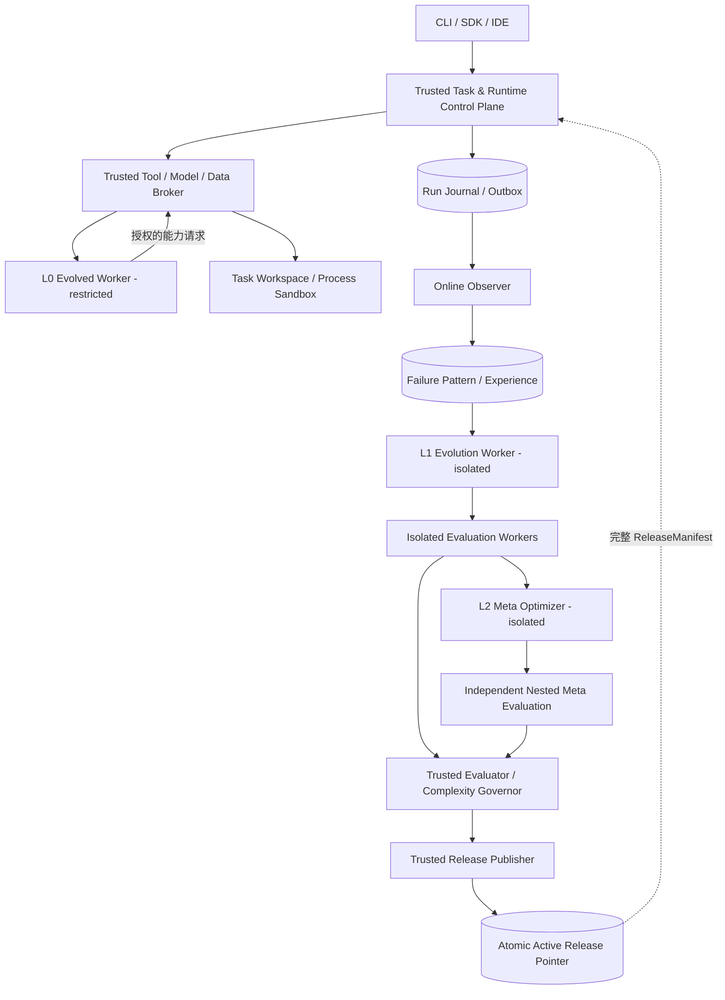

# repo-code v1.5｜技术架构、接口契约与受约束 RSI 实现设计

> **状态**：`DESIGN_REVIEW_V1.5` · 2026-10-30 · 全部为**待实施规范/示例**，不表示已有源码或实验成果。  
> **配套文件**：[01｜业务与总体架构设计](01_repo-code_Architecture_and_Business.md)  
> **关键词**：Coding Agent Runtime、Evidence-Grounded Targeted Evolution、Meta-Evolution、Complexity-Constrained Evolution、Trusted Evaluation & Promotion。  
> **不变业务边界**：独立 Coding Agent；项目理解是辅助开发能力，不做教学、岗位分析或与 CareerForge 绑定。

---

## 0. 设计摘要、版本差异与形式化目标

### 0.1 设计目标

以**模块化单体 + 独立低优先级 Evolution Worker** 为初期架构，优先实现日常可靠编码，再将真实执行轨迹转换为可审计的定向优化实验。

- **L0**：单主 Agent 动态循环，真实执行文件、进程、调试与测试；统一安全执行入口。
- **Online Observation**：只记录必要事实与低成本异常指纹，不在模型调用关键路径执行复杂 LLM 归因。
- **L1**：从已确认值得优化的 Failure Pattern 定位相关的最小缺陷范围，生成受约束的**替换、简化或其他候选**，在隔离环境验证。
- **L2**：改进 L1 的归因、候选生成、搜索与实验选择，允许参数、算法和内部拓扑演化；独立元评测。
- **Trusted Governance**：不可被候选修改的安全执行、独立验收、Complexity Governor、版本晋升权限、审计事实。

要优化的是**未来真实编码任务的净收益**，而不是“越进化代码越多”“当前候选自评更好”或“在来源题上重新答对”。

### 0.2 v1.1 → v1.2 变更表

| 项目 | v1.1 基线 | v1.2 规范 |
|---|---|---|
| 进化触发 | 轨迹归因与候选提议 | **L0 异常轻量检测 → Pattern Registry → 离线 Triage → 定向诊断** |
| 优化范围 | 多组件可进化清单 | 不遍历全部组件，定位**最小必要修复路径** |
| RSI 分层 | 主要讨论 Coding Harness 进化 | 正式纳入 L0/L1/L2，L2 可改进 L1 的参数、算法与内部拓扑 |
| 代码膨胀 | 发布与回滚 | **复杂度多维预算 + 简化/淘汰 + 候选/生产空间隔离** |
| 进化动作 | 通用 Candidate | `TUNE/REPLACE/SIMPLIFY/MERGE/REMOVE/ADD`，新增必须说明必要性 |
| 效率 | 离线评测 | **双速路径、渐进式评测、低优先级资源调度、搜索停止条件** |
| 发布 | 质量/安全/成本 | 增加不可自改的 **Complexity Governor** 和 Meta-Evaluation |

### 0.2.1 v1.2 → v1.3：Review P1 阻断项修复

本版回应九项上一轮评审问题（五项 P1 + 四项配套修复），不以追加一句原则代替可执行协议。详细证据与前后规则见 [03｜Review 修复矩阵](03_Review_Fix_Matrix.md)。

| 修复主题 | v1.3 不变量 |
|---|---|
| Steering 与验收 | **每个 Run 固定一个 TaskSpecRevision 与 AcceptanceContractRevision**；目标/范围变更走 successor Run |
| 交付证据 | **最终产物、被测代码、测试定义/收集范围、环境、检查定义**须形成完整的验证绑定 |
| 组合一致性 | **整份 ReleaseManifest 原子 CAS 激活**；禁止不同组件独立晋升后拼接未经评测的组合 |
| 生产隔离 | 经批准的**可进化代码仍在受限 Evolved Worker 运行**，不能 import 到高权限 Host |
| Holdout 防污染 | 开发集与晋升/最终隐藏集分域；通过学习血缘传播曝光标记；必要时使用新的独立样本 |
| Complexity 阶段 | S4 首次晋升前必须具备 Trusted Minimal Governor；S5 仅增加高级分析与淘汰 |
| Final Holdout | G4b 冻结后一次性终审，合格才允许 G5 激活；失败阻止该发布 |
| 安全抢占 | 专门的高优先级安全控制通道，撤销/停止/隔离不排在正常 Run 后面 |
| L2 自修改 | S6 前关闭；S6 使用**完整嵌套搜索过程**比较 MetaOptimizer，包含全部候选及成本 |

### 0.2.2 v1.3 → v1.4：第二轮 Review（2 P1 + 4 P2）

本版新增六项强制契约，见 [03｜第二轮修复矩阵](03_Review_Fix_Matrix.md)：

| 评审项 | v1.4 冻结规则 |
|---|---|
| P1-A · 判定进程可被被测代码干预 | **可信外部裁判与被测进程权限/解释器隔离**；同进程 pytest 只作为有限可信度诊断，不能单凭它认证关键外部行为 |
| P1-B · Broker 断线后不知执行状态 | 稳定 `operation_key` + 语义参数摘要 + Broker 持久化 Ledger；同键同参查询原 Operation，同键异参拒绝，未知副作用进入对账 |
| P2-C · 验证证据对象混淆 | `SOURCE / BUILD / ARTIFACT` 三类 Subject，分别验证源快照、构建关联、实际交付二进制；按 Contract 的证据组合判定 |
| P2-D · Memory Run 快照缺失 | `knowledge_snapshot_digest` + `knowledge_index_digest` 固定为 Run/Trial 输入；个人/项目记忆独立于软件 Release 更新 |
| P2-E · Meta 候选生成器与评测实例身份冲突 | `MetaCandidateBuilder` 不能看隐藏题；**冻结的** `MetaOptimizerInstance` 只接收被分配题目的 `VisibleMetaProblemEnvelope`，不可见私有 oracle/其他题 |
| P2-F · Greenfield 缺少初始验收 | 开始编码 Run 前完成 `PRECONTRACT_DISCOVERY → REVIEWABLE → FROZEN` 的行为/接口约定与独立必需检查建立；覆盖不足不得 VERIFIED |

以上为 **repo-code 提议的工程契约**，不是声称 SWE-bench、Codex、Temporal 或 LangGraph 已实现同名对象。

### 0.2.3 v1.4 → v1.5：第三轮 Review（2 项 P1）

两项均为**正式交付阻断条件**，不能通过声称“上游冻结时会检查”或者“异步任务迟早会发现新指令”来替代实际契约。具体反例见 [03｜Review 修复矩阵](03_Review_Fix_Matrix.md)。

| 评审项 | v1.5 不变量 | 最晚实现阶段 |
|---|---|---|
| **P1-G · Required Check 全集漏验** | 冻结 Contract 时验证 `required_checks`、覆盖引用、显式 `global_required_checks` 的关系；每次最终验收必须**先独立验证全部必需检查**，再验证每条必需需求的覆盖，禁止 coverage 遍历代替全集 | **S1 / 首个 VERIFIED 前** |
| **P1-H · Steering/Cancel 与验收提交竞态** | Steering/Cancel 的**持久化接纳**与 `DeliveryRecord` 原子提交在同一可信 Run/Task 状态存储上串行化；验证结果只是 Prepared Decision，最终 CAS 必须再次检查 `control_epoch`、当前 Run、状态、未决事件、工作区 fencing、终态唯一性 | **S1 最小协议；S2 完整 Steering** |

`control_epoch` 是**可信控制状态的单调序列**，不属于随 Run 固定的 `RunManifest` 配置。每次合法控制事件接纳都提升它；冻结的 `TaskSpec/Contract/Release/Knowledge` 仍保持原规则。

工程参照：[SQLite 官方事务与隔离](https://www.sqlite.org/isolation.html)（本地单写事务和 `BEGIN IMMEDIATE`）；[Temporal Updates/消息处理](https://docs.temporal.io/develop/python/message-passing)（区分消息被接纳与处理完成）。**实际 P1-G/P1-H 协议是 repo-code 自行制定的约束**，并非这些项目内置的同名逻辑。

### 0.3 系统成功的必要条件

真实产品价值需要同时满足：

1. 编码任务具备可执行验收证据；
2. 每个 Run 固定 TaskSpec、验收契约与整份 ReleaseManifest，不热替换组件；
3. 单次错误不自动引发昂贵 RSI；
4. 进化结果在**独立、未用于调参的任务**上可重复；
5. 能区分 `Fail→Pass` 与 `Pass→Fail`，安全和复杂度门禁不可被综合分数抵消；
6. 生产激活的组件、知识和额外模型调用保持在明确预算内；
7. L2 不得生成新管理层或修改其可信评测者；
8. 生产可进化代码始终运行在独立权限域，不能持有用户源码根目录、密钥或发布写权限；
9. 评测门禁必须将测试定义、被测源、检查配置、环境、实际收集项与最终交付物绑定；
10. 隐藏集反馈流向、候选血缘与优化器学习关系必须可追踪，污染后不能复用为未见样本。
11. 关键外部行为的判定由与被测代码隔离的可信裁判执行，检查进程内的 pytest 绿色报告不足以独立证明交付正确。
12. Broker 对具有副作用的提案使用稳定 Operation 身份及持久化去重；网络重连不产生第二次执行。
13. 每份验收证据显式说明 SOURCE/BUILD/ARTIFACT Subject 与判定可信级别，不可伪造跨 Subject 测试事实。
14. Run 和 Trial 固定 Knowledge Snapshot；记忆变更不隐式改变运行中的模型输入。
15. Meta-Eval 的候选生成器与冻结待测实例严格分身份和数据权限。
16. 从零开发必须先建立足够的、经独立注册的验收行为与接口契约，空或不足检查不得 VERIFIED。
17. 每个冻结 Contract 的 `required_checks` 全集均必须独立经过可信验证；覆盖映射只决定需求是否充分覆盖，不能吞掉全局必需检查。
18. 验收判断不等于交付提交；Steering/Cancel 持久化接纳与成功提交必须有**唯一的事务顺序**，旧 `PreparedDecision` 遇到控制状态变化必须失效。

---

## 1. 运行平面、生产隔离与信任边界



**物理信任边界**：`Trusted Control Plane` 与 `Evolved Worker` 必须是不同权限主体。Host 不 import 候选、获批的进化代码或动态生成的 Python 模块；生产环境也不例外。`Evolved Worker` 只能通过固定 IPC/能力代理请求模型、文件片段、工具等授权能力。

**v1.4 双重隔离原则**：`Evolved Worker / Task Sandbox` 与 `Trusted Grader` 不仅要分进程，还应由操作系统权限、独立运行环境和只读证据通道隔离。保护测试文件本身不等于保护测试**解释器、插件、断言函数或报告生成状态**。可信判定器不能在自己的解释器/进程中 import 用户提交的任意 Python 包。详见 §13.1。

### 1.1 权限矩阵：候选与生产代码必须同样隔离

| 资源/操作 | 可信 Host / Broker | 生产 Evolved Worker | L1/L2 实验候选 | 受限任务执行器 |
|---|---|---|---|---|
| 用户源仓库与未提交修改 | 按授权管理、创建任务快照 | **无直接挂载**；通过 Broker 获取受限内容 | 仅合成/授权的实验副本 | 按任务所需挂载工作副本 |
| Shell、MCP、文件写入 | 执行授权、预算、审计 | **无直接执行权**；发送 ToolProposal | 仅隔离试验/受限工具 | 按授权执行，隔离用户源仓库 |
| API Key、模型凭据 | 独立保管，通过代理调用 | **不可读凭据** | 不可读生产凭据 | 仅明确授权且必要的密钥注入 |
| Session/Run/Approval/验收事实 | 读写权威状态 | 只见脱敏、受限 DTO | 读授权的实验数据 | 仅执行结果回传 |
| 发布指针、GatePolicy、复杂度预算 | 可信 Publisher 唯一可写 | 无权 | 无权 | 无权 |
| `promotion/final/meta_*` 隐藏任务与逐项结果 | 独立评测器可读 | 不可读 | 不可读 | 仅当前题允许的公开输入可见；私有 grader 永不挂载 |
| 公网与任意文件系统 | 按 Host 管理策略 | 默认无；不可独立开放 | 默认无；试验专用策略 | 沙箱按最小权限配置 |

生产 Evolved Worker：只读固定 digest 的发布包、只读 rootfs、非特权身份、无用户主目录/状态目录/凭据挂载；受控资源与网络；显式 IPC 限流、schema 校验、capability scope、Run ID 与 token audience 绑定。它可以请求 Broker 执行工具，但**所有审批、路径/操作校验、预算与效果日志都在 Broker/Control Plane 内再次判断**。收到候选注入的 Prompt、工具描述或请求均按不可信输入处理。

`Tool ACI`/`Context Policy` 等白名单模块可在此 Worker 内改变内部算法、拓扑与 Prompt，但外部 DTO、操作协议、认证和验收接口不可自行更换。默认仅可从现有签名发布产物选择被批准的完整版本；下载/安装受信任构建与启动时校验 digest 由 Host 完成。

**运行中沙箱丢失时失败关闭**：不默默降级到高权限 Python 进程；新 Run 不启动。S0–S3 的人工编写基线可沿可信开发路径运行，但**S4 的自主生成/修改代码上线前必须实现并验证生产隔离**。容器配置是否足够强仍需真实 OS/运行时安全测试，不因目录白名单而自动成立。

### 1.2 三种并存的独立空间

- `Trusted Control`: 独立权限主体，管理权威事实、权限、验收、评测数据和发布；不加载可进化 Python。
- `Production Evolved Runtime`: 只能执行已发布完整 ReleaseManifest 指定的组件，保持被批准的沙箱/资源限制；任务工作区的副作用只经 Broker。
- `Evolution/Evaluation`: 未晋升候选在沙箱内运行，独立模型与文件权限，绝不共享活动用户工作目录、生产凭据或隐藏测试原文。

### 1.2.1 可信评测判定域（新增）

| 执行主体 | 可执行什么 | 不得拥有的权限/数据 | 信任解释 |
|---|---|---|---|
| `Untrusted DUT Process` | 用户项目、`pytest`、构建脚本、依赖及插件 | Trusted Grader 私有代码/答案/报告写权 | **进程内全部可变状态均视为被测对象可干预** |
| `Trusted Test Orchestrator` | 从受保护 Contract 发起检查、隔离任务、观察退出/接口输出 | 不在自身进程 import DUT | 只能证明它真正发起的、可审计检查 |
| `Trusted External Grader` | 独立判断 HTTP/CLI/IPC 结果、检查输出工件与必要状态 | 不运行 DUT 任意 Python/插件、禁止 DUT 写判定状态 | 强于同进程 pytest；仍受测试覆盖限制 |
| `Trusted Evidence Store` | 保存受权原始响应、Subject 指纹和带签名/受控写入报告 | DUT/Task Worker 不能改写 | 区分工具输出与可信裁决 |

`pytest`、其插件与依赖即使来自只读测试文件，只要与 DUT 在同一个可变解释器内执行，`assertEqual`/插件 Hook 等判定与报告可能受 DUT 影响。**同进程通过 ≠ 可信外部裁判通过**。对于无法黑盒访问的库，可由受限子进程提供固定的序列化函数适配器；裁判仍在外部进程比较实际输出，不在可信进程 import 库。对于无法充分隔离或构造可观察 oracle 的任务，返回 `PARTIAL (INSUFFICIENT_EVIDENCE)`，不假装已经充分验证。

### 1.3 参考成熟项目的设计依据

- [OpenAI Codex App Server](https://openai.com/index/unlocking-the-codex-harness/) 区分持久 Thread/Turn、Client/App Server 和 Core，支持进行中的交互及审批；repo-code 在其思路上进一步**人为要求 TaskSpec/Contract 冻结与 successor Run**，不是声称 Codex 自带相同约束。
- [Running Codex safely](https://openai.com/index/running-codex-safely/) 明确沙箱是技术权限边界、审批决定何时问用户，二者不可互相替代。repo-code 采用 Trusted Broker 加 Worker 的更严格进化代码发布边界。
- [Claude Code Checkpointing](https://code.claude.com/docs/en/checkpointing) 明确文件快照覆盖范围有限，Shell 等副作用不能被当成通用可回滚事务；因此 repo-code 保守处理未知效果。

## 2. 技术栈与部署形态（建议）

| 关注点 | 方案 | 取舍 |
|---|---|---|
| 语言与协议 | Python 3.11+、asyncio、Pydantic v2、typing | 结构化消息/异步调用/可测试状态机 |
| 模型 SDK | 独立 OpenAI 与 Anthropic Provider adapter | 原生 Tool Use、stream、usage、错误语义分别适配；不靠假兼容掩盖差异 |
| 持久化 | SQLite WAL + 事务事件日志 + 私有内容寻址 Artifact Store | 本地单用户足够；不可将 SQLite 事务视为跨文件系统 ACID |
| CLI | 轻量 CLI + 流事件显示 | 产品能力先于 UI 美化；未来 IDE/Web 重用 Task API |
| 工程工具 | 受控文件 API、ripgrep、可选 Tree-sitter/LSP、pytest/ruff 等 | 索引是辅助编码能力，按需启用 |
| 任务隔离 | 独立任务副本/worktree；L1 可信本地 / L2 经验证容器 | Git worktree 不是进程沙箱 |
| 扩展 | Skills 标准文件、MCP 客户端、按需子 Agent | 所有调用经统一 ToolGateway |
| 评测 | 固定 TaskManifest、真实端到端 Runner、Fake Provider 安全回归 | 用户任务评测与进化试验严格分开 |
| 进化搜索 | 规则 + LLM 定向生成 + 受限候选搜索 | 首版无需重型 Bayesian/RL/分布式搜索 |
| 向量索引 | 仅在 BM25/结构索引不足且有实验收益时启用 | 不预先引入大型向量数据库/图数据库 |

L0 与 EvolutionWorker 可以先部署为同机**不同进程**，使用同一持久化服务的数据协议，但各自拥有独立权限和资源配额；在用户任务活跃时暂停或降级进化任务。实际系统不能以“独立进程”冒充强隔离。

---

## 3. 建议代码边界与依赖方向

> 目录名为设计建议；不是已经创建的文件清单。

```text
repo-code/
├── cli/                        # 会话、任务与版本命令；不拥有执行事实
├── api/                        # SDK/传输 DTO、事件流；后续 Web/IDE 接入
├── ai/                         # Provider protocol + OpenAI / Anthropic adapters
├── runtime/
│   ├── kernel.py               # 权威 Run 生命周期与恢复入口
│   ├── agent_loop.py           # 单主 Agent 动态采样/工具循环
│   ├── task_state.py           # 不可变 TaskSpecRevision / 有界执行 directive
│   ├── successor.py            # 合约变化后创建 successor Run
│   ├── release_manifest.py     # 全量版本固定
│   ├── knowledge_pin.py        # 运行级知识快照与刷新策略
│   ├── budgets.py              # 预算与预占
│   ├── outbox.py               # 关键事件事务持久化
│   └── manifest.py             # 固定的运行配置清单
├── execution/
│   ├── tool_gateway.py         # 唯一 Tool Call 入口
│   ├── broker_ipc.py           # request/reconnect/query 的有版本协议
│   ├── operation_ledger.py     # 持久化请求键、去重、结果与对账状态
│   ├── file_change.py          # Change IR / 版本安全写入
│   ├── workspace.py            # 原工作区基线与任务副本
│   ├── process_manager.py      # 可追踪进程生命周期
│   ├── sandbox.py              # 环境隔离抽象
│   ├── mcp_adapter.py          # 外部工具代理（非权限旁路）
│   └── acceptance.py           # Host 注册的验收条件
├── acceptance_bootstrap/
│   ├── requirement_matrix.py   # 从目标提取可观察行为与覆盖映射
│   ├── interface_contract.py   # 测前接口/输入输出约定
│   └── check_proposal.py       # 与实现者隔离的验收候选
├── context/
│   ├── assembler.py            # 模型视图投影
│   ├── artifacts.py            # 原始内容回取
│   ├── memory.py               # 有来源的经验条目
│   └── skills.py               # Skill 生命周期/检索
├── observation/
│   ├── event_consumer.py       # 从 Outbox 消费事件
│   ├── rule_detector.py        # L0/L1 轻量确定性信号
│   ├── pattern_registry.py     # 去重、模式合并、观察计数
│   └── provenance.py           # 证据与哈希关系
├── evolution/
│   ├── triage.py               # 价值/修复可能/风险/资源筛选
│   ├── localizer.py            # 关键步骤与问题路径定位
│   ├── hypothesis.py           # 有支持/反证的根因假设
│   ├── candidate_search.py     # 定向搜索 + TUNE/REPLACE/.../ADD
│   ├── adapters/              # 不同可进化组件的候选适配器
│   ├── trial_runner.py         # 隔离开发集评测
│   ├── lineage.py              # 候选 DAG / Provenance
│   └── meta/                   # L2 元候选与元试验
│       ├── meta_search.py
│       ├── meta_trial.py
│       └── meta_lineage.py
├── evolved_worker/            # 经批准的 L0/L1/L2 可变代码受限执行进程
│   ├── worker_runtime.py
│   └── broker_client.py
├── trusted/
│   ├── control_broker.py       # 唯一能力代理，绝不 import 可变模块
│   ├── verification_evidence.py  # 三类 Subject 与最终交付证据绑定
│   ├── external_grader.py      # 禁止 import DUT 的可信外部判定器
│   ├── check_contract_factory.py # 验收检查注册、审查与冻结
│   ├── knowledge_snapshot.py   # 版本化知识 Manifest/ACL / pin
│   ├── operation_reconciler.py # Broker 操作未知效果与断线恢复
│   ├── holdout_vault.py        # 受限反馈与污染血缘
│   ├── emergency_channel.py    # 独立撤销/停止控制面
│   ├── release_publisher.py    # 整份 ReleaseManifest CAS
│   ├── policy_enforcer.py      # 不可自修改的权限强制边界
│   ├── evaluation_gate.py      # 不可自修改的独立评测与硬门禁
│   ├── complexity_governor.py  # 不可自修改的复杂度预算
│   └── audit_store.py          # 不可由候选更改的事实/完整性
├── storage/                    # SQLite Schema / migrations / private artifacts
│   └── exposure_lineage.py     # 隐藏评测曝光与派生污染图
├── tests/                      # 契约、安全、故障注入、Benchmark
└── configs/                    # 非秘密的版本化静态配置
```

`ai` 不依赖 `execution`；`runtime` 调用抽象 ToolGateway，`evolution` 只引用公开候选/评测协议；`trusted` 不依赖动态加载的进化候选代码。规则检查必须配合独立进程/权限防护，不能只依赖目录结构。

---

## 4. L0 AgentLoop：动态执行、Host 事实与任务内纠错

### 4.1 循环伪代码

```python
# 协议示意，非可运行项目源码
async def run_agent(run_id: str):
    while not runtime.is_terminal(run_id):
        runtime.check_and_reserve_budget(run_id)
        runtime.apply_pending_steering_at_safe_point(run_id)
        manifest = runtime.get_pinned_release(run_id)
        # 动态进化代码只在受限 Worker 内运行；模型调用由可信 Broker 代为执行
        context = await worker_context_engine.build_projection(run_id)
        assistant = await trusted_broker.sample_model(
            run_id, context, tool_schemas=trusted_broker.authorized_tool_schemas(run_id),
            pinned_release=manifest.digest,
        )
        runtime.append_assistant_event(run_id, assistant)

        if assistant.tool_calls:
            # 即使被调用的 Worker 已获批发布，Broker 仍逐个重新检查权限和副作用
            # Host 先将每个 ToolCall 固定为持久化 tool_call_uid；重连时不可重分配
            proposals = runtime.persist_tool_call_uids(run_id, assistant.tool_calls)
            results = await trusted_broker.dispatch_tools(proposals, run_id=run_id)
            runtime.append_tool_results_idempotent(run_id, results)  # UNIQUE(run_id, operation_id)；不重复注入模型历史
            continue

        if assistant.requests_finish:
            # prepare 不写 SUCCEEDED/DeliveryRecord。进入 VERIFYING 并读取控制 epoch、
            # 封存验证对象与工作区写者代次，评测可异步完成。
            intent = runtime.prepare_verification_intent(run_id)
            decision = await acceptance_engine.evaluate(intent)
            commit = runtime.try_commit_delivery(intent, decision)  # 原子 CAS，§4.3.2
            if commit.status == "COMMITTED":
                return commit.delivery  # 只返回已持久提交的事实
            if commit.status == "STALE_CONTROL":
                # steering/cancel 或执行偏好在验收期间接纳；不报告旧 VERIFIED
                return runtime.route_control_or_resume(run_id)
            if commit.status == "REVERIFY_REQUIRED":
                runtime.append_verification_feedback(run_id, commit)
                continue
            runtime.append_verification_feedback(run_id, decision)
```

- 模型请求文本结束不等于任务 `VERIFIED`。
- 同批独立只读工具允许有界并发；写入、进程和外部副作用默认串行。
- 预算、当前用户硬约束、审批状态在 Runtime 权威存储；Context 折叠不能修改它们。
- 用户 `steer` 须先写入**持久化、带序号的 ControlInbox**才可确认 `admitted`，分类/应用可能稍后完成；未分类事件也阻断旧完成提交。`admitted`、`classified`、`applied` 不得混称。相关旧 Proposal 审批失效。
- `acceptance_engine.evaluate()` 仅生成带状态版本的 `PreparedDecision`；`try_commit_delivery()` 是唯一成功发布入口。取消/目标变更接纳早于提交则成功 CAS 必须失败。
- Run 结束前应清理或明确保留进程租约，状态未知时不能伪造成功。

### 4.2 Domain State：TaskSpec 和 Run 的契约关系

| 实体 | 精确定义与不变量 |
|---|---|
| `Session` | 多轮交互历史，可包含多个任务及 successor Run；不是验收主体 |
| `Task` | 一个用户目标族，由不可变 `TaskSpecRevision` 版本组成 |
| `TaskSpecRevision` | 某版本的目标、功能要求、允许变更范围、验收意图；**单个 Run 固定一个** |
| `ExecutionDirectiveRevision` | **不改变验收**的执行偏好/展示与收紧安全指令，可在同 Run 安全点追加 |
| `AcceptanceContractRevision` | Host 注册的必需检查、受保护检查源、范围与人工条件，**单 Run 不变** |
| `Run` | 一个固定 `TaskSpecRevision + AcceptanceContractRevision + ReleaseManifest` 的执行尝试 |
| `Operation` | 稳定 `(run_id, turn_id, tool_call_uid)` 和语义参数 digest，Broker 唯一持久化账本；可为 `UNCERTAIN`，重连只查询原 Operation |
| `VerificationEvidence` | 有 `SOURCE/BUILD/ARTIFACT` Subject、判定信任级别和实际检测结果；依契约组合检查而非强制全部绑定二进制 |
| `DeliveryRecord` | 固定 `run_id / task_spec_revision / contract_digest / final source/artifact / release / knowledge_snapshot`，包含可信提交事件序号；仅原子提交后可对外称 `VERIFIED` |
| `ControlInboxEvent` | 用户 Steering/Cancel 的幂等接纳事件，带 `control_event_id / task_id / run_id / control_epoch / state`；未知类别也占用提交栅栏 |
| `RunControlState` | 可变的 `control_epoch`、当前运行状态、取消标记、未决事件数、任务当前 Run 指针及工作区写者 epoch；**不在冻结 RunManifest 内** |
| `VerificationIntent` | 承载检查前的观察版本、封存交付对象、工作区 fence、必需检查集合摘要；仅表示准备评测，不代表交付成功 |
| `OutcomeCommit` | `DeliveryRecord`、`Run.status`、审计事件与通知 Outbox 在**同一可信事务**原子写入；唯一终态防重复提交 |

运行状态增加非成功终态 `SUPERSEDED`，并引入过渡状态 `SUSPENDING_FOR_SUCCESSOR`。允许的关键转移为：`RUNNING/WAITING_USER/WAITING_APPROVAL/INTERRUPTED → SUSPENDING_FOR_SUCCESSOR → SUPERSEDED`（工作区写入/外部效果已确认）；若资源或效果不确定则 `SUSPENDING_FOR_SUCCESSOR → NEEDS_RECONCILIATION`，之后**只能经显式对账**回到可确认状态，不得为了生成 successor 把它标为完成。任何新 Run 取得工作区唯一写者权之前，必须证实旧 Run 不会继续写入；终态 `SUCCEEDED/FAILED/CANCELLED/SUPERSEDED` 的旧 Run 本身不再恢复执行。`DeliveryOutcome.PARTIAL` 仍不能投影为 `SUCCEEDED`。`Session` 历史及用户约束可以跨 Run 延续，但旧审批、旧验收证据及旧验收结果不继承。

### 4.3 两类 Steering：按是否改变验收语义分类

| 用户举例 | 类别 | Host 动作 |
|---|---|---|
| “回答短一点”“先读报错日志”“先运行已有测试” | `EXECUTION_ONLY`（检查定义与目标不变时） | 同 Run：追加 `ExecutionDirectiveRevision`；安全点应用，重验未执行 Proposal |
| “不要使用某类危险 Shell 命令” | 权限收紧且不改目标时为 `EXECUTION_ONLY`；否则 `CONTRACT_CHANGE` | 即时收紧策略，撤销冲突审批；若影响验收定义/范围，走 successor |
| “再加权限检查”“新增接口”“删除原需求” | `CONTRACT_CHANGE` | 建立新的 TaskSpec/Contract 和 successor Run |
| “禁止修改登录模块”“不得添加依赖” | 一旦改变允许变更范围/验收不变量 | `CONTRACT_CHANGE`，新 Run 冻结规则 |
| 模糊或两类兼有的请求 | `UNCERTAIN` | 先请求确认或按 `CONTRACT_CHANGE` 保守处理，不沿旧契约宣告成功 |

Steering 判别可以有 LLM 提议，但必须经可信 Host 的**结构化字段差异**验证：目标、必需检查、要求、禁止范围、保护文件或验收覆盖任一变化就不是仅执行指令。安全政策紧缩可立即阻止危险动作；无法安全证明的变更禁止在旧 Run 下完成。

```python
class SteeringDecision(BaseModel):  # 契约示意
    steering_id: str
    run_id: str
    classification: Literal['execution_only','contract_change','uncertain']
    task_spec_revision: int
    expected_run_revision: int
    user_text_artifact_id: str
    effect_on_acceptance: bool

class SuccessorLink(BaseModel):
    old_run_id: str
    new_run_id: str
    old_task_spec_digest: str
    new_task_spec_digest: str
    old_contract_digest: str
    new_contract_digest: str
    inherited_workspace_snapshot_digest: str
    resolved_operation_cursor: str
```

**执行协议**：收下指令 → CAS 记录 → 阻止旧 Run 创建新副作用 → 当前工具/进程在可信执行器中完成、取消或对账 → 撤销相关待批准 Proposal → 校验稳定工作区快照 → 构造新 `TaskSpecRevision` 与 Host 冻结的新 Contract → 新建 successor Run → 新预算在 Task 级总限额内核算 → 新 Run 重新验证。旧 Run 仅在副作用确认且已冻结快照时进入 `SUPERSEDED`；无法证明停止时标 `NEEDS_RECONCILIATION`，不得绕过工作区写者锁开启继承写入。

**任务范围变更与交付绑定**：旧 Run 的合法结果可作为上下文线索或现有文件基线，但**不能继承旧验收证据**；继承发生的是受核验的文件状态，不是“已通过所有测试”的声明。新 Run 交付只有其当前 TaskSpec、Contract、Release、最终快照均一致时才可 `VERIFIED`。

### 4.3.1 Greenfield 验收建立：从用户目标到可冻结检查（v1.4）

**不能把“实现 Agent 写了哪些测试”当成首次验收标准**。启动正式编码 Run 前的只读 `PRECONTRACT_DISCOVERY` 负责将自然语言需求转为 `RequirementCoverageMatrix` 与 `InterfaceContract`。必要时由独立验收设计器使用 LLM 提议检查，但**注册权在 Trusted Host/授权审查者**；实现 Agent 无权自行删除或弱化。建立顺序：

`USER_GOAL → observable requirements → provisional API/CLI/HTTP contract → trusted check proposals → independent review/oracle validation → coverage gate → FROZEN AcceptanceContract → Coding Run`。

状态 `DRAFT → REVIEWABLE → FROZEN → SUPERSEDED`；在 `FROZEN` 前不能把构建任务作为可宣告 `VERIFIED` 的正式编码 Run 启动。若外部接口还不明确，先冻结用户可观察的输入/输出、错误语义与安全行为，不将某个内部函数名当成强制要求；关键歧义请求用户决策，非关键假设明确写入审查记录。可允许标记为 `EXPLORATION_ONLY` 的原型执行，但其结果不得 `VERIFIED`，正式功能开发须进入新 Run。

`RequirementCoverageMatrix` 每条必需要求至少有 `requirement_id / criticality / observable_behavior / check_ids / oracle_kind / coverage_status`，含安全/异常/边界负例。对无法自动验证的要求允许 `HUMAN_ACCEPTANCE`，但必须由真人明确完成授权判断；没有充分可信检查时返回 `outcome=PARTIAL, verification_reason=INSUFFICIENT_EVIDENCE`，不是空集真（vacuous truth）。实现 Agent 后续新增测试仍只能补充；需求变化走 §4.3 successor Run 和新契约。

**v1.5 冻结附加门禁**：`required_checks` 中每个受保护 `check_id` 必须已注册且有效，并且要么关联必需需求，要么显式列于 `global_required_checks`（例如全局静态/安全检查）；覆盖矩阵内全部引用必须有合法定义。冻结时拒绝无来源、已停用或未覆盖/未标记为全局的必需检查。**运行时仍要逐项校验 required_checks 全集，不能假定冻结器永不出错。** 详见 §13.1.3。

例：FastAPI JWT 登录接口，先确定 `POST /login` 的成功/失败语义、无效 token 应拒绝访问、最小安全负例；然后由 Trusted Check Builder 登记独立 HTTP 黑盒检查。实现可以采用不同内部包结构，但不能自行删除这些行为检查。

### 4.3.2 Steering/Cancel 接纳与交付提交的原子顺序（v1.5 · P1-H）

**线性化点（linearization point）必须在同一可信持久化存储中**。HTTP/IPC 进入进程不等于指令已经被正式接纳；只有 `ControlInboxEvent` 已提交，系统才可向客户端确认 `ADMITTED`。控制指令分类和在 Agent 安全点应用是后续阶段，不能让耗时的 LLM 分类期间出现成功提交漏洞。

| 时序/动作 | Trusted Host 事务规则 | 正确对外语义 |
|---|---|---|
| `ADMIT_STEERING`，无论尚未分类还是已知目标变更 | 幂等写 `ControlInboxEvent`、`control_epoch += 1`，将 Run 置于控制待处理/阻断完成状态；必要时设置 `SUSPENDING_FOR_SUCCESSOR` | 先收到旧成功的评测**不等于可提交**；不等待 LLM 归因完成才建立栅栏 |
| `ADMIT_CANCEL` | 幂等写事件、提升 `control_epoch`、置 `cancel_requested`、立即触发安全停止通道 | 在完成提交前接纳的 Cancel 必须阻断旧成功 |
| `CLASSIFY/APPLY EXECUTION_ONLY` | 可在原 Run 继续，但提升后的 epoch 不回退；必须重新准备最终决定，按情况复用**仍有效**的测试证据 | 旧 PreparedDecision 不再可提交；不必无意义地重跑未失效测试 |
| `CLASSIFY CONTRACT_CHANGE` | 旧 Run 对账和封存后 `SUPERSEDED`，基于新 Contract 创建 successor | 旧 Run 不得在已接纳新目标后提交 VERIFIED |
| `COMMIT_DELIVERY` | 在同一事务内检查 Run 和 Task 的**当前指针、epoch、状态、未决控制事件、取消标记、工作区 fence/封存快照和唯一提交约束**，原子写入 `Run.status=SUCCEEDED`、`DeliveryRecord`、审计事件、通知 Outbox | 只有事务 COMMIT 成功之后才展示 VERIFIED/推送成功通知 |
| 控制事件**后于**已提交交付 | 不能倒改历史 Delivery；新需求创建下一 TaskSpec/Run，取消返回已结束状态或转为后续任务的取消 | UI 显示准确的当前目标与历史已完成版本，不能将旧版本误当新目标已经完成 |

**最小持久化字段**：`RunControlState(run_id, task_id, control_epoch, state, cancel_requested, pending_control_count, current_task_revision, workspace_writer_epoch)`；`Task(active_run_id, task_revision)`；`ControlInboxEvent(event_id UNIQUE, run_id, received_sequence, status, raw_request_digest)`；`VerificationIntent(run_id, observed_control_epoch, expected_run_state, task_revision, contract_digest, final_snapshot_digest, workspace_writer_epoch, required_check_set_digest)`；`DeliveryRecord(run_id UNIQUE, commit_sequence, intent_digest, ...)`。

**原子入口协议（说明性伪代码；此处不得执行异步 LLM、测试或外部工具）：**

```python
# on client ingress: 承诺 accepted 前必须先持久化栅栏
async def admit_control(event):
    with trusted_db.write_transaction():  # SQLite BEGIN IMMEDIATE / 其他 DB 等效锁与 CAS
        if already_recorded(event.event_id):
            return existing_admission(event.event_id)
        run = lock_current_run(event.run_id)
        if run.is_terminal():
            return route_after_terminal(event)  # 旧 Run 不再被可变地“取消/改写”
        persist_control_inbox(event, state=("PENDING_CANCEL" if event.kind == "CANCEL" else "PENDING_CLASSIFICATION"))
        increment_run_control_epoch(run)
        fence_completion_and_conflicting_effects(run, event)
        persist_control_event_and_outbox(event)
    return admission_receipt(event.event_id, state="ADMITTED")

# evaluate 在事务外完成：返回的是 PreparedDecision，而不是 DeliveryRecord
async def prepare_delivery(run_id):
    intent = trusted_runtime.begin_verification_with_sealed_snapshot(run_id)
    return intent, await acceptance_engine.evaluate(intent)

# 同一个数据库事务内进行最后原子检查与事实写入
# required_checks/coverage、证据与封存对象已在 prepare/evaluate 阶段验证，
# commit 再验证其哈希绑定、有效期、写者 fencing 与最新控制状态。
def try_commit_delivery(intent, decision):
    with trusted_db.write_transaction():
        task, run = lock_task_and_run(intent.run_id)
        if task.active_run_id != intent.run_id:
            return STALE_CONTROL
        if task.task_revision != intent.task_revision:
            return STALE_CONTROL
        if run.task_spec_revision != intent.task_revision:
            return STALE_CONTROL
        if run.acceptance_contract_digest != intent.contract_digest:
            return STALE_CONTROL
        if run.control_epoch != intent.observed_control_epoch:
            return STALE_CONTROL
        if run.state != "VERIFYING" or run.cancel_requested:
            return STALE_CONTROL
        if has_pending_control_events(run.id):
            return STALE_CONTROL
        if not sealed_snapshot_and_fence_still_valid(intent, run):
            return REVERIFY_REQUIRED
        if not frozen_contract_and_required_evidence_still_valid(intent, decision):
            return REVERIFY_REQUIRED  # 包含 required_check_set_digest、Evidence/Contract 全绑定
        if not no_unresolved_operations(run.id):
            return REVERIFY_REQUIRED
        if not decision.verified:
            return NOT_VERIFIED
        # 同一事务：唯一约束避免重入/多完成协程重复交付
        insert_delivery_record_once(intent, decision)
        transition_run_to_succeeded(run)
        append_outcome_commit_event_and_notification_outbox(run)
    return COMMITTED  # 通知投递在提交后，失败可由 Outbox 重试
```

**工作区原子性**：外部检查在**已封存且不可被工作区 Writer 修改的候选源/工件快照**上执行；Delivery 指向同一封存内容。如果只锁数据库而允许其他进程在事务外修改待交付文件，数据库 CAS 不能保护文件系统，不能据此声称最终交付正确。Broker/Workspace 写者锁、OS 隔离、`workspace_writer_epoch` 与最终文件摘要复核共同阻止“检查通过后换包”。发生非法外部写入则 `REVERIFY_REQUIRED`，并不得发布旧文件。

**客户端确认顺序**：若 `ADMIT_STEERING/ADMIT_CANCEL` 的事务先提交，旧 `try_commit_delivery` 必须因 epoch/状态/待办事件失败；若 `COMMIT_DELIVERY` 先提交，旧交付历史有效，新目标只能作为后续版本处理。不能凭网络包到达时刻宣称两者谁先正式接纳；返回的事件序号与最终提交序号提供可审计顺序。重复同一事件 ID 返回原始接纳状态，不产生新的控制修订。

**工程参考**：SQLite [Isolation](https://www.sqlite.org/isolation.html) 和 [Transaction](https://www.sqlite.org/lang_transaction.html) 提供本地写事务串行化基础；Temporal [Workflow Message Passing](https://docs.temporal.io/develop/python/message-passing) 区分消息接纳与完成。repo-code 的 `control_epoch` 和 `DeliveryRecord` CAS 属于自定义设计，不是直接调用 Temporal 即可获得的语义。

### 4.4 RunManifest：固定一次 Run 的完整执行组合

```yaml
run_id: "uuid"
session_id: "uuid"
task_id: "uuid"
task_spec_revision: 5
execution_directive_revision_at_start: 3
acceptance_contract_id: "contract-id"
acceptance_contract_revision: 2
acceptance_contract_digest: "sha256:..."
release_manifest_digest: "sha256:FULL-RELEASE" # 唯一激活单位
workspace_baseline_digest: "sha256:..."
knowledge_snapshot_digest: "sha256:KNOWLEDGE-SNAPSHOT" # 项目/个人记忆内容与作用域 ACL 的冻结 Manifest
knowledge_index_digest: "sha256:KNOWLEDGE-INDEX"       # 由相同 Snapshot 派生的检索视图
knowledge_snapshot_revision: 17
check_contract_bootstrap_digest: "sha256:REQUIREMENT-COVERAGE"
environment_digest: "sha256:..."
model_request_config_digest: "sha256:..."
permission_policy_digest: "sha256:..."
budget: {model_calls: 30, tool_calls: 100, wall_seconds: 600}
```

同一 Run 不切换 `TaskSpecRevision / AcceptanceContract / ReleaseManifest / knowledge_snapshot_digest`；只允许经过 Host 分类的执行偏好、单调权限收紧和预算内的动态策略，所有更新有审计序号。模型别名与环境外部漂移必须记录，不能仅凭声明的模型名称认定可重现。

### 4.5 DeliveryRecord：不能以模型的终止响应作为成功证据

```yaml
delivery_id: "uuid"
run_id: "uuid"
task_spec_revision: 5
acceptance_contract_digest: "sha256:..."
release_manifest_digest: "sha256:..."
knowledge_snapshot_digest: "sha256:KNOWLEDGE-SNAPSHOT"
knowledge_index_digest: "sha256:KNOWLEDGE-INDEX"
final_source_digest: "sha256:SOURCE-ONLY" # 依据 Contract 的源文件范围；不等于包括产物/日志的 workspace
final_workspace_digest: "sha256:..."
final_deliverable_artifact_manifest_digest: "sha256:..." # 若发布二进制或打包交付
required_verification_evidence_ids: ["ev-source", "ev-build", "ev-artifact"] # 实际由 Contract 声明，SOURCE-only 无需伪造 ARTIFACT
requirement_coverage_digest: "sha256:COVERAGE-MATRIX"
required_check_set_digest: "sha256:REGISTERED-REQUIRED-CHECKS"
external_grader_report_digest: "sha256:EXTERNAL-VERDICTS"
verification_intent_digest: "sha256:SEALED-INTENT"
committed_control_epoch: 12   # 事务时仍等于 PreparedDecision 所见 epoch
workspace_writer_epoch: 7    # 可信 fence 与封存对象绑定
outcome_commit_sequence: 184  # 与 Run 状态/通知 Outbox 同事务生成
outcome: "VERIFIED"  # or PARTIAL/BLOCKED/FAILED/CANCELLED
coverage: "registered_checks_only"
```

Host 在发布交付物之前重新计算最终受保护源指纹、产物指纹、知识快照以及**必需检查全集**；任何 `CheckEvidence` 对不上就失效并返回 `REVERIFY_REQUIRED`。`VERIFIED` 的 `DeliveryRecord` 只能经 §4.3.2 的事务性 `OutcomeCommit` 生成：不得先写记录再等待 Steering 分类，不允许旧契约或旧检查覆盖新目标。

## 5. ToolGateway：唯一执行入口、版本写入与外部副作用

### 5.1 ToolSpec 与副作用分类

```python
# 接口草图：字段与方法需要实现前冻结
class SideEffectClass(StrEnum):
    READ = "read"
    WORKSPACE_WRITE = "workspace_write"
    PROCESS = "process"
    EXTERNAL = "external"
    UNKNOWN = "unknown"

class ToolSpec(BaseModel):
    name: str
    input_schema: dict
    capability_set: set[str]
    side_effect: SideEffectClass
    timeout_seconds: float
    output_limit_bytes: int
    retry_contract: str
```

**唯一入口顺序**：`Schema → Workspace/Capability/Safety Constraints → Approval → Budget Reservation → Durable Intent → Sandbox Execution → Actual Result & Version → Durable Event → ToolResult`。

对未知 MCP/脚本副作用按 `UNKNOWN` 处理，不能因 Server 声称 `readOnly` 就认定无副作用。任何通过 Shell 运行的非可信代码，都可能绕开应用层受控文件 API；只有经过验证的 OS/容器隔离和有限权限才能限制其实际能力。

### 5.2 安全文件修改链

`WorkspaceChangeSet → 只读规划 → 路径/目标冲突/文件版本验证 → Diff → 权限绑定 → 持久化前后意图与恢复字节 → 稳定路径锁 → 落盘前重验 → 原子操作 → 后态核对 → 操作效果事件`。

- 创建、编辑、删除、移动均使用显式操作类型；不允许把模型输出当作已落盘事实。
- 基于 SHA-256 等实际版本进行前置/后置比较；外部变更不能被旧版提案覆盖。
- 文件系统与 SQLite 非跨介质原子事务：硬崩溃后要通过 Journal 校验前后态；不确定状态进入对账。

### 5.3 进程、测试与外部执行

| 操作结果 | 自动重试条件 |
|---|---|
| 只读查询 | 仍被授权、参数合法，可重新检查 |
| 未落盘且状态确定的文件提案 | 重新依据新版本规划 |
| 写入效果不确定 | 禁止盲重试，先 Journal 对账 |
| 构建/测试超时 | 必须确认子进程停止和任务 `replay_safe` 条件；否则等待对账 |
| 外部 MCP 写入未知 | 默认不再次提交；读取外部状态或人工处理 |

任务工作区**隔离用户原始脏工作区**（含未跟踪文件和未提交变更）；集成回用户目录前重新检查基线，不自动清理或覆盖用户文件。Git worktree 不等于进程沙箱。

---

### 5.4 Broker IPC：幂等提交、重连查询与效果对账（P1-B）

**边界**：解决 Worker ↔ Broker 在本地重复提交/回复丢失时的**请求身份一致性**；不承诺任意 Shell、外部 MCP 或跨进程操作天然 exactly-once。协议由可信 Broker 而不是 Evolved Worker 实现，首次受理时将 `tool_call_uid` 与原始模型 ToolCall/Turn 持久化；重连重放必须沿用原键，不允许生成新 UID 规避去重。

```python
class ToolOperationRequest(BaseModel):
    protocol_version: int
    run_id: str
    turn_id: str
    tool_call_uid: str                   # Host 首次接纳时分配并持久化，重连不变
    tool_name: str
    tool_spec_digest: str
    arguments: dict                     # canonical JSON，禁止浮点/编码歧义
    expected_state_digest: str | None
    approval_scope_digest: str | None      # 首次提案时申请的稳定范围；后续审批决定另记 Ledger

class OperationReceipt(BaseModel):
    operation_key: str                   # H(run_id, turn_id, tool_call_uid)
    request_semantics_digest: str        # H(tool_name/spec/args/前置条件/审批作用域...)
    operation_id: str                    # Broker 首次注册时稳定分配
    status: str                          # REGISTERED / WAITING_APPROVAL / AUTHORIZED /
                                         # EXECUTING / SUCCEEDED / FAILED / UNCERTAIN / CANCELLED
    result_artifact_digest: str | None
    reconciliation_ref: str | None
```

**提交协议**：`SUBMIT(request)` 先对规范化语义请求进行 hash（审批结果后续更新 Ledger，不能变更既有请求摘要），Broker 使用数据库唯一索引 `(run_id, turn_id, tool_call_uid)` **同事务注册持久 Ledger 与 Intent**，之后才授权/执行。相同 `operation_key` + 同语义 digest 返回原 `OperationReceipt` 或已提交的原 Result，不创建第二个执行；同 key 不同语义 digest 返回 `IDEMPOTENCY_CONFLICT`，永不覆盖旧内容。`GET_OPERATION(operation_key)` 为只读查询并要求 Run/能力鉴权，所有旧权限撤销/Run 终止状态在恢复与执行前再次核验；`LIST_UNRESOLVED(run_id)` 只供 Host 恢复，不能越权查看他人 Run。重复连接/重复进程按唯一键和 CAS 控制一个执行所有者。

状态转移的效果顺序：`REGISTERED → WAITING_APPROVAL/ AUTHORIZED → EXECUTING → SUCCEEDED/FAILED`；`EXECUTING` 写入 Ledger 并持久化关联的执行租约/外部 request ID **早于实际副作用**；完成后先持久化结果/后态指纹和 Result，**再回复** Worker。`CANCELLED` 只表示能够确认尚未执行或效果已按相应操作协议确认停止，不能把未知效果伪装为取消成功。

**重复结果写入**：权威 Run Journal 对 `(run_id, operation_id)` 设置唯一约束，Broker 已完成的同一 Result 即使被多次交付，也只在模型上下文中生成一条 ToolResult；不会重复扣预算或触发 AgentLoop 下一步。恢复时不能将重新包装的 Result 当成全新 ToolCall。

**断线恢复**：Worker 重新连接只能先 `GET_OPERATION`：已终结返回原结果；仍执行则等待/查询原 Operation；状态未知进入 `UNCERTAIN`、触发可信 Reconciler 查文件后态/进程租约/外部 ID。对于外部服务，若服务自身提供 idem token，可透传同一稳定 token；否则即使 Broker 本地去重也**不能**保证外部效果 exactly-once。Broker 崩溃发生在真实副作用之后但 Result 持久化之前时，不允许再次执行该 Op，先对账，必要时人工判定。Ledger/tombstone 保留期必须覆盖可恢复 Run 与外部幂等窗口，超期的请求键不允许在同 Run 被重新分配。

**必须的故障注入**：`SUBMIT` 注册前断线、注册后执行前断线、执行后/结果提交前崩溃、**提交结果后/发送响应前断线**、并发相同键、同键异参、进程超时仍活、外部副作用无幂等能力；每一用例均验证效果次数/不确定状态/审计事实，禁止靠重复 Tool Call 偶然“修好”。设计借鉴 [AWS EC2 Client Token](https://docs.aws.amazon.com/ec2/latest/devguide/ec2-api-idempotency.html) 的重复键参数冲突规则与 [Temporal Activity 生命周期](https://docs.temporal.io/tasks) 对执行丢失/重试的处理思想；这**不是**宣称本地 Ledger 已实现分布式 exactly-once。

## 6. Context、Memory、Skills 与原始事实分离

为了支持 RSI 定向分析而不是“模型凭摘要讲故事”，数据层采用四种概念：

| 层次 | 数据 | 不变量 |
|---|---|---|
| **L0 Raw Evidence** | 原始模型与工具事件、完整输出、检查、补丁、进程租约 | 受保护、带 hash/版本、允许本地回取 |
| **L1 Structured Experience** | 任务症状、原因假设、操作经验、适用条件与反证 | 有 `source_trace_ids`，模型提取不视为事实 |
| **L2 Retrieval View** | BM25、元数据索引、可选 Embedding / Cross-Encoder | 派生索引，失效可重建；检索不授权行为 |
| **L3 Lifecycle Governance** | 候选/活跃/归档、版本、效用、引用、清理保护 | 横跨各层；不能用记忆摘要替换权威状态 |

ContextEngine 应提供原始历史与当前模型视图的分离。折叠必须保持 ToolCall/ToolResult 完整组，避免打断未完成动作；大日志保存为 Artifact + 有界摘要/引用，按需回取。用户硬约束来自 TaskState 而非模型摘要。

Skill 的语义相似度不等于可合并：合并必须同时考虑作用域、语言/框架、工具权限、前置条件与负例；候选从成功或失败经验提取后仍需要独立任务验证。默认优先 BM25/元数据过滤，密集检索和 Cross-Encoder 需通过召回及额外成本消融后启用。

---

### 6.1 Memory/Knowledge 的 Run 级冻结与生效时间（P2-D）

软件发布组合与知识输入是**两个版本维度**。`ReleaseManifest` 继续固定 Context/SkillRetriever 代码和通用索引配置；用户/项目记忆通过独立的内容寻址 `KnowledgeSnapshotManifest` 固定到 Run，**不将每次个人记忆更新变成一次软件 Release**。典型字段：

```yaml
# KnowledgeSnapshotManifest（从下述字段计算 digest，不包含 digest 自身）
revision: 17
scope: {user_scope_id: "user-redacted", project_scope_id: "project-redacted"}
item_manifest_digest: "sha256:ITEMS-AND-TOMBSTONES"
access_policy_digest: "sha256:READ-SCOPE-POLICY"

# KnowledgeIndexManifest（独立派生；与 source snapshot 无哈希循环）
source_knowledge_snapshot_digest: "sha256:KNOWLEDGE-SNAPSHOT"
index_builder_version_digest: "sha256:INDEXER"
retrieval_index_digest: "sha256:INDEX-BUILT-FROM-SOURCE-SNAPSHOT"
```

`RunManifest / TrialRecord / ContextProjection / DeliveryRecord` 必须记录 `knowledge_snapshot_digest`，Run/Trial 另固定 `knowledge_index_digest`（指 IndexManifest 的规范化内容摘要；它包含派生索引工件 digest 及源 Snapshot digest，不包含它自身）；后者单向引用前者，且读取和 BM25/向量索引来自**同一**冻结快照；索引可以异步重建，但不能悄悄切到包含更多条目的实时索引。模型中临时推理笔记、工具本轮输出与当前会话事件属于 **Run-local Working State**，可以逐步变化，不等于跨 Run 长期记忆更新。

本 Run 产生的新长期 Memory/Skill 先写入 `KnowledgeDraft`；经来源/权限审查后生成新 Snapshot，只在**后续新 Run** 生效。如果用户在当前任务中要求立即启用新知识，Host 可建立**同 Task/Contract 的 successor Run**，冻结新 Knowledge Snapshot，继承已对账工作区但重新核验必需检查；不进行隐式中途切换。遇到隐私删除/ACL 撤销，安全政策立即阻断旧快照访问，必要时停止 Run 并重新取可用快照；删除后的原始材料不得为了回放而非法保留，审计中只留允许的 tombstone/元信息。

L1/L2 Trial 必须固定相同或显式对照的 `knowledge_snapshot_digest` 和 index 版本，隐藏集评测不能读取未经授权的用户个人记忆。LangGraph 将 thread checkpoints 与跨线程 Stores 区分，给出了状态与长期知识应独立管理的工程参考；本项目另外提出 Run 固定快照的不变量，不声称 LangGraph 自带此策略。

## 7. Online Observation：低开销但不丢关键事实

### 7.1 可信事件与 Observer 派生事件

Runtime/ToolGateway 对**关键副作用意图和执行结果**进行事务持久化，采用 Outbox/有序事件号，不能为了减少延迟将其降为可丢的日志。

Online Observer 只消费**已提交**且被授权进入经验学习范围的事件：生成异常指纹、增量计数和模式候选。**Hidden Evaluation Run（Promotion/Final/Meta）在运行时标记 `evaluation_visibility=TRUSTED_ONLY`，不得写入 L1/L2 可见的普通 Trajectory/Problem/Experience Store**；否则即使后来限制报告权限，隐藏轨迹仍会经观察者泄漏。重连接后按 `(run_id, sequence)` 补读，消费端幂等；可重新构建派生索引。

若 Observation Worker 繁忙或崩溃，用户任务在保有必要审计事实的前提下继续；恢复后补处理。队列压力过大时可跳过或合并**可重建的低优先级派生通知**，但不得静默丢弃关键执行和安全事件。关键持久化故障应以失败关闭处理，不能假装操作已安全完成。

### 7.2 事件 Envelope

```json
{
  "event_id": "uuid",
  "run_id": "uuid",
  "sequence": 184,
  "schema_version": 1,
  "timestamp": "2026-10-30T09:00:00Z",
  "type": "tool.operation_finished",
  "payload": {
    "operation_id": "uuid",
    "tool_name": "shell",
    "effect_status": "completed",
    "exit_code": 1,
    "error_fingerprint": "sha256:<...>",
    "artifact_ids": ["artifact-01"]
  }
}
```

审计事件默认脱敏；原始 stdout/stderr/源码在私有 Artifact Store，按权限读取。对实验分析模型提供数据前必须进行范围控制和凭据保护。

### 7.3 轻量异常规则（设计示意）

典型 `ineffective_retry`：命令规范化标识、执行 cwd、**相关代码/依赖/环境状态指纹**、错误类别与指纹相同；期间没有新增证据或明确需要重试的理由；达到受控重复阈值才记录问题候选。

```python
# 只生成症状，不直接诊断根因；语义与阈值待设计评审
if (
    repeated_same_action
    and same_relevant_state
    and same_failure_signature
    and no_new_evidence
    and not known_transient_failure
):
    observer.emit_symptom("ineffective_retry", source_event_ids)
```

- “相同错误字符串”不足以证明同一失败模式。
- 相关状态指纹须来自可信、可维护的增量状态；不应每个 Tool Call 都哈希全仓库。
- 网络暂时性失败、flaky test、外部状态变化要有反例和 `INCONCLUSIVE` 路径。
- 此处在线识别**症状**，不是启动完整 LLM 诊断，更不是修改 Harness。

---

## 8. Failure Pattern Registry：证据与问题聚合

### 8.1 从单次症状到可复用问题

```python
# Pydantic 形状示意
class ProblemRecord(BaseModel):
    problem_id: str
    run_id: str
    event_range: tuple[int, int]
    symptom_code: str
    evidence_ids: list[str]
    relevant_state_digest: str | None
    observed_outcome: str
    classification: str = "untriaged"

class FailurePattern(BaseModel):
    pattern_id: str
    signature_version: int
    symptom_family: str
    applicability: dict[str, str]
    supporting_problem_ids: list[str]
    contradictory_problem_ids: list[str] = []
    current_status: str
    related_candidate_ids: list[str] = []
```

**索引建议**：先使用确定性标签（错误类别、命令类型、相关状态、策略版本和任务类型）生成粗粒度指纹，去重后在离线阶段做必要的语义聚类；每个 Pattern 保留支持/反证的 `ProblemRecord`，不能把相似问题当成已证明的同一根因。

状态建议：`OBSERVING → ELIGIBLE_FOR_TRIAGE → DIAGNOSING → READY_FOR_EXPERIMENT → IN_EXPERIMENT → RESOLVED/COOLDOWN/ARCHIVED`，并允许 `INCONCLUSIVE`，禁止从 `OBSERVING` 直接跳 `CHAMPION`。

### 8.2 Triage 的职责

输入：模式历史、跨任务频率、实际失败严重度、复现可行性、可修复性假设、预计评测成本、风险、同类候选历史效果。

输出建议：`IGNORE_AS_TASK_ERROR / WAIT_FOR_EVIDENCE / ESCALATE_SECURITY / SCHEDULE_TARGETED_EVOLUTION`，附有证据与理由。

可以使用可解释的优先级规则；若有多个值得改进的 Pattern，再按有限预算排序。不规定“一种错误出现 3 次必然启动”的全局规则，单次严重安全事件单独处理但不得绕过可信发布。

---

## 9. Failure Localization：定向归因，不遍历所有组件

### 9.1 诊断协议

```python
class RootCauseHypothesis(BaseModel):
    hypothesis_id: str
    pattern_id: str
    statement: str
    suspected_component_ids: list[str]
    supporting_evidence_ids: list[str]
    contradicting_evidence_ids: list[str]
    confidence_kind: str  # observed | plausible | inconclusive
    proposed_probe_ids: list[str]

class DiagnosisReport(BaseModel):
    pattern_id: str
    critical_event_ids: list[str]
    hypotheses: list[RootCauseHypothesis]
    conclusion: str  # testable | inconclusive | environment | trusted_safety
```

推荐步骤：

1. `EvidenceExtractor` 提取最小相关事件窗口（包含已持久化的用户约束、环境版本、工具结果）。
2. `CriticalStepLocalizer` 用确定性不变量识别导致任务偏离的关键步骤，必要时由轻量 LLM 给出**带引用的**多个假设。
3. `CausalHypothesisGenerator` 检查 Harness 中与该步骤有关的可进化实现：例如错误显示、Context 选择、重试策略，而非列举全部组件。
4. 对支持与反证做一致性核对；证据不足则 `INCONCLUSIVE`，不得强行选择一个组件。
5. 输出待测试的最小必要修改面（一个组件优先，确有依赖时允许有限的相关组件集），并定义能证伪该假设的反例任务。

**单次 LLM 的归因不是因果证明。** 候选修改后的受控 A/B 实验提供干预性证据，但如果同时改 Prompt/Tool/Memory 多项，不能将收益随意归给其中一项。必要时设计有限析因对照。

### 9.2 结构化的修复靶点

修复靶点应输出 `component_id, current_digest, file_allowlist, hypothesis, minimal_change_contract, expected_effect, side_effect_risks, probe_suite`。对于不在白名单内的内容直接拒绝/改走人工问题流程，不得通过扩大范围自我授权。

---

## 10. L1 Targeted Evolution：候选类型、搜索、停止条件

### 10.1 六类操作语义

```python
class EvolutionOperation(StrEnum):
    TUNE = "tune"          # 保留架构，调整参数
    REPLACE = "replace"    # 用新实现替换旧实现
    SIMPLIFY = "simplify"  # 合并条件、减少重复步骤
    MERGE = "merge"        # 合并冗余模块/Skill/Memory
    REMOVE = "remove"      # 移除证据支持的无效机制
    ADD = "add"            # 不存在合理替代时新增
```

**不是强制排序算法**，而是候选的偏好和新增举证义务：一个 `ADD` 候选要写明为什么现有 `TUNE/REPLACE/MERGE` 无法合理解决该缺陷；不必为证明这一点实际生成所有其他类型候选。

### 10.2 候选协议

```python
class EvolutionCandidate(BaseModel):
    candidate_id: str
    pattern_id: str
    base_champion_digest: str    # 兼容标签，必须等于 base_release_manifest_digest
    base_release_manifest_digest: str
    target_component_ids: list[str]
    operation: EvolutionOperation
    artifact_digest: str
    candidate_release_manifest_digest: str   # 最终评测绑定整份组合
    change_scope: list[str]
    hypothesis_id: str
    source_trace_ids: list[str]
    predicted_benefit: str
    known_risks: list[str]
    required_contract_suite_ids: list[str]
    status: str  # PROPOSED ... APPROVED/REJECTED/ACTIVE
    lineage_parent_ids: list[str] = []
```

候选产物可以是配置、Skill 文件或代码补丁；所有候选均必须指向**不可变的完整 ReleaseManifest 基线版本与精确修改范围**，不能在搜索中偷偷改变同一候选的基线或评测器。

### 10.3 搜索策略（先采用可解释的有限搜索）

- 只对一个 `FailurePattern` 的相关修复靶点生成少量差异明显的候选（开发初始可试 3—5 个候选，**非已验证最优参数**）。
- 静态去重（产物哈希、变更集合）与必要的语义重复检查；不堆积几乎相同的 Prompt 版本。
- 在开发集观察失败与成本后可有限修订候选；设置候选数、迭代轮数、调用预算、总费用和时间上限。
- 如果候选失败的证据说明原假设错误，回到**问题诊断**而不是无限生成新补丁。
- 无正向证据、复杂度持续上升、连续搜索无收益或超预算 → `COOLDOWN/ARCHIVED`。
- 真实实验结果存档以供未来归因与 L2 学习，但不注入生产主循环。

### 10.4 在线与候选代码执行的边界

L1 可以提出白名单内的**非安全 Harness 代码补丁**，但不能当场 import 到可信 Host；隔离构建、静态检查、受限候选执行、代码级人工审核后，生产也必须以相同原则将该类代码运行于**独立权限域**。审核通过的是某份 digest 确定的发布包，不是赋予代码永久超级用户权限。详细参见 §1.1 和 §16。


---

## 11. L2 Meta-Evolution：参数、算法和内部架构

### 11.1 三个演化等级

| 类别 | 实际变更 | 示例 | 发布边界 |
|---|---|---|---|
| `PARAMETER` | L1 可配置阈值、搜索权重、预算分配策略 | `ExperimentSelector` 的样本排序参数 | 可信 Meta-Gate 后受限发布 |
| `ALGORITHM` | L1 具体算法和实现 | 单次 LLM 归因换成规则+证据校验+LLM 假设 | 代码契约/安全回归+审批 |
| `INTERNAL_TOPOLOGY` | L1 内部模块划分与调用 DAG | `FailureAnalyzer → EvidenceExtractor + Localizer + HypothesisGenerator` | 全量独立元评测+人工批准 |

这些等级不是要求必须先把所有参数穷举一遍；能证实结构问题时可以直接提出结构级候选。**破坏外部契约的 Schema 变更属于人工治理迁移，不是普通元候选自动发布**。

### 11.2 MetaCandidate 与自修改范围

```python
class MetaCandidate(BaseModel):
    candidate_id: str
    base_optimizer_digest: str
    target_optimizer_ids: list[str]  # FailureLocalizer / CandidateSearch / ExperimentSelector ...
    change_level: str              # PARAMETER / ALGORITHM / INTERNAL_TOPOLOGY
    allowlisted_paths: list[str]
    new_artifact_digest: str
    source_experiment_ids: list[str]
    hypothesis: str
    required_meta_suite_ids: list[str]
    contract_version: int
    status: str
```

L2 可以优化自身**可进化的搜索/候选/实验策略实现**，只产生下一版本候选；不允许修改正在执行的 L2 过程、MetaEvaluator、PromotionGate、Governor、安全规则或隐藏数据。**递归是 V1→V2→V3 的同层版本更新，绝不自动生成 Level 3。**

### 11.3 Meta-Evaluation：冻结候选生成器 vs. 被测优化器实例（P2-E）

**两个身份严格分开**：

| 身份 | 所在阶段 | 可见输入 | 禁止访问 |
|---|---|---|---|
| `MetaCandidateBuilder` | Meta-Dev/生成优化器版本 | 历史允许学习的 Dev 优化任务、已允许的非隐藏经验 | `meta_promotion/meta_final` 题库、题目正文、oracle、隐藏轨迹与私有报告 |
| `FrozenMetaOptimizerInstance` | 独立 Meta-Eval 的单个 episode | **当前已分配**的 `VisibleMetaProblemEnvelope`：Failure Pattern、公开 Dev 证据、初态、允许修改范围与预算 | 当前题隐藏答案/评分代码/其他题、其他 cohort 状态、可信评分和未来题目 |
| `TrustedMetaEvaluator` | 独立执行和评分 | 全量题目+隐藏结果/评分器，仅对可信报告存储写入 | 不能被候选代码加载、覆盖或借工具读取 |

`MetaCandidateBuilder` 先在 Meta-Dev 上训练/搜索并产生**冻结** optimizer release digest；Trusted Scheduler 在候选冻结后才逐题创建隔离 `FrozenMetaOptimizerInstance`。这不是“被测优化器禁止读取任何题目”，而是**不得提前阅读尚未分配的隐藏题**。正式运行时实例当然要获得当前题目允许公开的输入，否则不能搜索。

```python
class VisibleMetaProblemEnvelope(BaseModel):
    assigned_episode_id: str
    public_problem_id: str                 # 当前题的临时公开 ID，非题库稳定索引
    initial_failure_pattern_digest: str
    initial_l1_state_digest: str
    initial_release_manifest_digest: str
    visible_dev_evidence_digest: str
    knowledge_snapshot_digest: str         # 当前题允许的冻结知识输入
    knowledge_index_digest: str
    allowed_change_scope_digest: str
    budget_contract_digest: str
    public_interface_contract_digest: str

class TrustedMetaProblemSecret(BaseModel):
    internal_problem_id: str               # 仅可信域
    grader_digest: str
    hidden_score_oracle_ref: str
    hidden_trial_suite_refs: list[str]
    cohort_digest: str

class NestedOptimizationEpisode(BaseModel):
    episode_id: str
    frozen_meta_optimizer_release_digest: str
    assigned_public_envelope_digest: str
    initial_l1_state_digest: str
    l1_candidate_ids_all: list[str]       # 含失败、提前淘汰者
    l1_trial_ids_all: list[str]
    all_search_cost: dict                 # 含 builder 成本按协议归集+内层搜索/试验成本
    proposed_champion_release_digest: str | None
    trusted_private_score_ref: str        # 仅可信域持有，不传回 instance
```

评测器以**完整嵌套搜索**为单位：同一批隐藏 cohort 的每道题分别为 V_old / V_new 创建干净、相互隔离的实例；两者以同一 `VisibleMetaProblemEnvelope`、同一预算与经过固定的初始 L1 状态启动。优化器可以在当前题允许的 Dev 子集执行多轮 L1 搜索；最后提出完整 Release 候选，Trusted Meta-Evaluator 在从未泄漏的题内隐藏检查中评分。总成本包含问题选择、所有候选、失败试验、评估与重试，不能只计算最后有效候选。比较质量、错误修复率、复杂度、回归和等预算净收益。

**隔离不变量**：题库源/隐藏 oracle 在实例文件系统与 Tool Broker 中不可见；每题使用独立目录/存储命名空间、缓存、索引、模型上下文与子 Agent 范围，且输入/输出数据均标记 hidden cohort 私有血缘；禁止跨题复用本次评测产生的长期 Memory、Skill 或 optimizer 状态。只向候选生成者发允许的有限发布裁决，任何借反馈修订后代候选都依 §13.3 的曝光规则换新 cohort。若无新独立题，保持 `meta_self_modify_enabled=false`。

**S6 前 `meta_self_modify_enabled=false`**；可以记录 L1 进化实验/人工研究 MetaOptimizer，但不自动晋升 L2 自改版本。本协议参考独立 Agent Eval 的 clean trial/评价隔离思想；“身份三分”和 envelope 字段是 repo-code 自定标准。

### 11.4 Meta 层的稳定契约

L1 对外需始终提供类似：

```python
class FailureAnalyzer(Protocol):
    async def analyze(self, pattern: FailurePattern, evidence: "EvidenceBundle") -> DiagnosisReport: ...

class CandidateSearch(Protocol):
    async def propose(self, diagnosis: DiagnosisReport, budget: "SearchBudget") -> list[EvolutionCandidate]: ...
```

内部可以变为一个模型调用、多个确定性工具或一个小型 DAG，但仍须接受冻结输入、返回合法的结构化数据、遵守资源/副作用权限，并保留必要证据。协议本身需要升级时，由人工通过 Schema Version 和兼容迁移批准。

---

## 12. Complexity Governor：防止系统变得臃肿

### 12.1 为什么 Complexity 不等于 LOC

仅限制新增代码行数会鼓励删除注释、转移复杂度到 Prompt 或生成更多子 Agent。Governor 应衡量**Production 的活跃复杂度**，而不是 Evolution Archive 中存有多少研究候选。

### 12.2 ComplexityVector（建议最小维度）

```python
class ComplexityVector(BaseModel):
    active_module_count: int
    public_contract_count: int
    dependency_edges: int
    dependency_cycles: int
    control_flow_complexity: float
    default_prompt_tokens: int
    enabled_tool_schema_tokens: int
    active_skill_memory_tokens: int
    active_subagent_role_count: int
    median_model_calls_per_task: float | None
    p95_task_latency_seconds: float | None
    evaluation_and_storage_bytes: int
```

`evaluation_and_storage_bytes` 用于管理**存储保留与维护**，并不意味着删除未解决恢复材料或必要审计事实；在生产复杂度判定中要单独看运行占用与归档体积，避免候选实验档案被错误算作运行时模块。

### 12.3 候选复杂度变化与判定

`ΔC = C(candidate) − C(champion)` 按每个维度记录。发布顺序为：

1. **不可违反的安全/接口/运行时约束**：违反即拒绝。
2. **资源/复杂度硬预算**：活跃依赖循环、不可授权新增能力、上下文与子 Agent 最大值等硬门槛不能被候选改变。
3. **受控质量-复杂度比较**：在硬预算内比较任务质量、失败回归、延迟与复杂度；可使用 Pareto 方案或预先冻结的加权规则，不凭空设置通用“每多 100 LOC 必须 +5%”指标。
4. **Growth Justification**：若 `operation=ADD` 或内部拓扑显著增长，附上现有实现不能胜任的具体失败证据、简化替代方案的讨论与后续淘汰计划。
5. **Simplification Review**：对重复模块/Skill、冗余规则和可移除旧实现提出非阻塞简化候选，但**不得为节约复杂度而削弱测试**；简化后重新验证。

S4 第一个 RSI Candidate 晋升前，最小可信硬预算必须已定义、可执行并与完整 ReleaseManifest 绑定；S5 再扩展冗余检测、主动简化与淘汰。实际硬限值在**设计冻结/实验开始前**根据平台预算设定，不能在看到候选成绩后更改，也不能被 L1/L2 附带补丁重写。人类可以通过独立变更流程调整预算，必须说明影响并版本化审批；这种调整不应自动替当前候选开绿灯。

### 12.4 探索、生产、保护归档三空间

| 空间 | 包含 | 安全约束 |
|---|---|---|
| `production/` | 当前已激活的**完整 ReleaseManifest** 及不可变依赖、有限回滚清单 | 生产任务只加载 RunManifest 绑定的完整组合 |
| `evolution/` | 有界 Candidate DAG、临时工作区、试验结果 | 独立环境，可修剪未引用临时计算缓存 |
| `protected_archive/` | 有引用的历史版本、签名清单、未解决恢复材料、必要审计记录 | 不能通过磁盘压力直接强删 |

Knowledge Store 中 Memory、Skills 也应有 `CANDIDATE → ACTIVE → DEPRECATED → ARCHIVED → PURGE_ELIGIBLE`，并依据依赖引用与保留政策清理。低使用率的安全相关经验不能直接被判定无用。

### 12.5 资源与递归停止条件

初期实验的建议配置（**仅作为待评测默认值**）：同一 Pattern 仅一个活跃 Evolution Run，单次搜索生成约 3—5 个候选、独立演化并发为 1、L2 层级固定且不允许新增 L3。所有实验还必须有不可绕过的绝对调用、时间、CPU/存储预算，阈值需评审冻结。

搜索停止原因至少包括 `BUDGET_EXHAUSTED / INCONCLUSIVE / NO_NET_GAIN / REGRESSION / COMPLEXITY_LIMIT / SAFETY_DENIED / PROMOTED`，不能无限生成版本，不能把“未找到更好版本”伪装成已进化成功。

---

## 13. 可信交付验证、隐藏数据隔离与整份 Release 原子发布（P1 修复核心）

### 13.1 可信交付：检查 Subject、外部裁判和有效证据（P1-A / P2-C）

#### 13.1.1 先冻结可信检查源，但不把只读 pytest 当作可信判定

`pytest` 的配置、收集、执行和结果报告由 plugin hooks 实现，DUT 若在相同 Python 解释器内运行，可能改变全局对象、fixture、插件行为、断言辅助函数或报告。**测试文件只读、Node ID 未变化、测试数量不变、最终哈希一致，仍不足以证明同进程 pytest 的判定未被内存篡改**。参见 [pytest Writing Plugins](https://docs.pytest.org/en/stable/how-to/writing_plugins.html) 与 [pytest Collection](https://docs.pytest.org/en/stable/reference/reference.html)。

`ProtectedRequiredCheckBundle` 仍由 Trusted Host/授权审查者注册受保护的测试定义、配置、插件、预期测试集合与允许 skip/deselection；`SupplementalAgentCheckBundle` 仅用于补充诊断。新增**执行者与裁判隔离**的强制规则：

- `Untrusted DUT Sandbox`：运行被测项目、开发依赖、项目 pytest、编译/安装脚本；可以生成 `DUTDiagnosticReport`，但其 stdout、JUnit、pytest 内部计数和退出码均为**被测域观测**，不得直接写可信 `VerificationVerdict`。
- `Trusted Test Orchestrator`：读取冻结 Contract 与只读封存输入，在独立权限域实例化 DUT Sandbox，检查实际代码/镜像/产物 digest，发出规范化测试输入并收集输出、进程和资源观测，不在自身进程 import DUT。
- `Trusted External Grader`：在独立解释器与 OS 安全域中，对 HTTP/CLI/IPC/文件工件等**外部可观察行为**作判定；自己的断言、oracle、插件与报告存储不可被 DUT 进程读写或导入。不能把隐藏答案/评分脚本挂入 DUT Sandbox。
- 对没有现成 API 的 Python 库，可在受限 DUT 进程内放置**固定版本、结构化调用适配器**，由可信外部裁判提供输入、接收序列化结果并判定，适配器和输出仍视为受限域产物。外部判定只证明观测到的行为及覆盖范围，不证明任意未测试输入/恶意测试感知代码都安全。

判定证据按级别记录：`TRUSTED_EXTERNAL`（隔离的黑盒行为裁判）、`TRUSTED_BUILD`（可信构建/工件绑定）、`SANDBOX_IN_PROCESS`（同进程 pytest 诊断）、`AGENT_SELF_REPORTED`（Agent 自述）。**关键功能的 VERIFIED 不得仅依赖后两种级别**；确无法获得覆盖需求的外部/受信任人工判断，交付 `outcome=PARTIAL` 且 `verification_reason=INSUFFICIENT_EVIDENCE`（后者是原因码、不是成功终态），不输出全量 VERIFIED。Trusted Orchestrator 的内存、文件、凭据与私有 oracle 必须在 DUT 进程之外以 OS/容器权限隔离，仅“新起一个 Python 进程”而同 UID 互相可改写不算充分。

#### 13.1.2 三种 Check Subject 不能通过一个等式混为一谈

| `subject_kind` | 检查对象 | 对最终交付的绑定 | 判定证据举例 |
|---|---|---|---|
| `SOURCE` | 源码/静态检查/同源运行的测试 | `tested_source_digest == final_source_digest`；**不得要求该检查拥有 wheel digest** | lint/typecheck/source pytest；若是同进程 pytest 仅作相应信任等级 |
| `BUILD` | 从指定源码到构建产物的关系 | `source_digest == final_source_digest` 且 `output_artifact_digest == final_deliverable_artifact_digest`；构建命令/工具链/输入环境固定 | 可信 Builder 调度与构建证明、安装包内容索引 |
| `ARTIFACT` | 实际 wheel/容器/可执行包及其运行行为 | `tested_artifact_digest == final_deliverable_artifact_digest`；检查安装/运行的就是此产物 | 隔离安装 wheel，可信外部接口测试/导入适配器输出 |

如果交付的是**仅源码**，Contract 可以只要求强度足够的 `SOURCE` 证据；如果交付可执行物，Contract 明确需要的 `SOURCE + BUILD + ARTIFACT` 组合。对无法生成可靠工件证明或关键运行检查的场景必须记录覆盖缺口。不能在 SOURCE 检查完成后“回填” wheel 摘要，以此伪造实际上未执行的产物测试。

```python
class CheckSubjectKind(StrEnum):
    SOURCE = "SOURCE"
    BUILD = "BUILD"
    ARTIFACT = "ARTIFACT"

class VerdictAuthority(StrEnum):
    TRUSTED_EXTERNAL = "TRUSTED_EXTERNAL"
    TRUSTED_BUILD = "TRUSTED_BUILD"
    SANDBOX_IN_PROCESS = "SANDBOX_IN_PROCESS"
    AGENT_SELF_REPORTED = "AGENT_SELF_REPORTED"

class VerificationEvidence(BaseModel):
    evidence_id: str
    run_id: str
    check_id: str
    subject_kind: CheckSubjectKind
    verdict_authority: VerdictAuthority
    task_spec_revision: int
    acceptance_contract_digest: str
    release_manifest_digest: str
    knowledge_snapshot_digest: str
    knowledge_index_digest: str
    check_definition_digest: str
    protected_check_bundle_digest: str
    test_config_digest: str
    loaded_test_dependencies_digest: str
    expected_collection_digest: str | None
    check_command_digest: str
    environment_digest: str
    grader_image_digest: str | None
    tested_source_digest_before: str | None
    tested_source_digest_after: str | None
    build_input_source_digest: str | None
    built_artifact_manifest_digest: str | None
    tested_artifact_manifest_digest: str | None
    actual_collected_ids_artifact: str | None
    executed_ids_artifact: str | None
    skip_deselect_ids_artifact: str | None
    trusted_observation_artifact: str | None
    raw_dut_diagnostic_artifact: str | None
    check_status: str                 # PASSED / FAILED / INVALID / INCONCLUSIVE

class FinalDeliveryBinding(BaseModel):
    run_id: str
    task_spec_revision: int
    acceptance_contract_digest: str
    release_manifest_digest: str
    knowledge_snapshot_digest: str
    knowledge_index_digest: str
    final_source_digest: str
    final_deliverable_artifact_manifest_digest: str | None
    requirement_coverage_digest: str
    required_evidence_ids: list[str]
```

#### 13.1.3 合同驱动的组合有效性，不使用“每项证据都等于最终 Artifact”的旧规则

```python
def evidence_matches_final(e, delivery, contract):
    if not common_binding_valid(e, delivery, contract):
        return False
    if e.check_status != "PASSED" or not permitted_authority(e, contract):
        return False
    if not protected_bundle_and_grader_valid(e, contract):
        return False
    if e.subject_kind == "SOURCE":
        return (e.tested_source_digest_before == e.tested_source_digest_after
                == delivery.final_source_digest)
    if e.subject_kind == "BUILD":
        return (e.build_input_source_digest == delivery.final_source_digest
                and e.built_artifact_manifest_digest
                    == delivery.final_deliverable_artifact_manifest_digest)
    if e.subject_kind == "ARTIFACT":
        return (e.tested_artifact_manifest_digest
                    == delivery.final_deliverable_artifact_manifest_digest)
    return False

def validate_contract_structure(contract, check_registry):
    # 冻结前在 REVIEWABLE 状态做结构验证；交付时再防御性重验。
    if not contract.mandatory_requirements:
        return False
    required = set(contract.required_checks)
    global_required = set(contract.global_required_checks)  # 明确声明的全局 lint、安全等检查
    if not required or len(required) != len(contract.required_checks):
        return False  # 重复的必需 Check ID 也不允许
    if not global_required <= required:
        return False
    if not required <= set(check_registry):
        return False

    referenced_required = set()
    for req in contract.mandatory_requirements:
        # 只允许受保护的必需检查计入强制需求覆盖；Agent 自测不得替代。
        refs = set(contract.coverage_matrix.required_checks_for(req))
        if not refs or not refs <= required:
            return False
        if not contract.coverage_policy_sufficient(req, refs, check_registry):
            return False
        referenced_required |= refs

    # 全部 CoverageMatrix 引用均必须注册、类型合法；辅助检查不能顶替 protected required。
    if not contract.coverage_matrix.all_check_refs() <= set(check_registry):
        return False
    # 未映射给任何必需需求的必需检查，必须显式列为 global_required。
    if required != (referenced_required | global_required):
        return False
    return all(check_registry[c].is_protected_active_for(contract) for c in required)


def delivery_verified(delivery, contract, check_registry, evidence_store):
    if contract.status != "FROZEN":
        return False
    if not validate_contract_structure(contract, check_registry):
        return False
    if not contract.coverage_sufficient:  # 缓存标记不能代替上面的实际结构检查
        return False

    required = set(contract.required_checks)
    # 第一关：独立遍历每一个已注册的必需检查，包括不归属特定需求的静态/安全检查。
    # 缺失、失败、跳过、证据失效一律拒绝；不从 CoverageMatrix 推导检查全集。
    for check_id in required:
        evidence = evidence_store.get(check_id)
        if evidence is None or evidence.check_id != check_id:
            return False
        if not evidence_matches_final(evidence, delivery, contract):
            return False

    # 第二关：逐条验证强制需求的可信覆盖及其 Subject/Authority 组合。
    for req in contract.mandatory_requirements:
        refs = set(contract.coverage_matrix.required_checks_for(req))
        if not refs or not refs <= required:
            return False
        if not contract.requirement_oracle_satisfied(
            req, {c: evidence_store[c] for c in refs}
        ):
            return False
    return no_unresolved_operations(delivery.run_id) and stable_final_snapshot(delivery)
```

这是**说明性伪代码**，其中 `check_registry`、`global_required_checks`、`coverage_policy_sufficient` 等是**拟增的可信契约字段/接口**，并非现有工程代码。冻结时由 Trusted Contract Builder 在 `REVIEWABLE` 状态执行 `validate_contract_structure`，通过后才将状态切换到 `FROZEN` 并记录 `required_check_set_digest`；如果既有 Contract/历史数据不符合结构校验，则**拒绝冻结或拒绝 VERIFIED**，而不是自动删除失配检查。验收不得依赖覆盖矩阵的 `required_checks_for(req)` 来构造全量待执行检查列表。实现还需校验：Contract 的 Subject 类型/状态机、实际收集/执行集合、未经许可的跳过、构建原料/依赖闭包、裁判可信运行域、最终产物不可变和可信报告签名。`SOURCE` 检查即使 `tested_artifact_manifest_digest=None` 仍可合法有效；`ARTIFACT` 证据不能只凭源码 pytest 替代。检查源、运行配置、插件/依赖、build output 或交付最终快照改变，则仅将**依赖该变化的证据**标记失效，并按 Contract 重新检查完整覆盖；不能选择性保留有利结果。

#### 13.1.4 证据采集与最终交付防替换

可信 Runner 的执行顺序：`可信注册检查全集 + CoverageMatrix 结构校验 → Contract冻结 → 沙箱与 Grader指纹验证 → 封存被测对象 → 执行全部 required_checks → 各 Subject 证据绑定 → 必需检查全集 PASS → 每条需求覆盖充分 → 形成 PreparedDecision → §4.3.2 最新控制状态/快照事务性 CAS → DeliveryRecord + Run SUCCEEDED + Outbox 原子提交`。验证协程不能在 `PreparedDecision` 阶段向用户发送“已交付成功”。

**效率边界**：L0 编码、即时调试阶段可以快速运行普通项目 pytest，并用它定位问题；严格外部裁判及完整 SOURCE/BUILD/ARTIFACT 证据链安排在正式交付验收、L1 晋升或必要的安全关口，不要求每次普通工具调用都启动独立评分环境。

`pytest` 的真实收集、执行、skipped/xfail/xpass/deselected 项目仍须记录，但同进程采集报告的权限等级是 `SANDBOX_IN_PROCESS`，不能被宣称为不可篡改的事实。被测代码/配置/检查定义的变化、Agent 删除或跳过必需测试，均不得“绿色通过”。Trusted Grader 的判断与结果必须由其**独占的受保护存储身份**提交，不能从 DUT 工作区 JSON 文件直接复制一份 `PASSED` 当作正式裁决。

外部裁判只能依据实际可观察行为和覆盖范围作结论，不能解决通用程序等价性问题。类似 SWE-bench 在隔离 Docker 中应用代码补丁并运行 Harness 测试提供了环境隔离的工程参照；本设计进一步要求可信裁判进程不加载被测 Python，是 repo-code 自己的强化规则。

### 13.2 Progressive Gate：G0—G5 与 Final Holdout 的确切位置

| Gate | 时机 | 必要证据 | 不通过后果 |
|---|---|---|---|
| `G0` | 候选形成 | Schema、白名单、权限、Trusted 源无修改、合法构建 | 立即拒绝 |
| `G1` | Dev 搜索 | 来源问题复现、针对性修复验证；可信外部 grader/Subject 证据链有效 | 有界修订或停止 |
| `G2` | Dev 搜索 | 相关任务、负例、已有成功任务、初步成本/复杂度 | 拒绝或有界修订 |
| **Freeze** | G2 后 | 完整 `CandidateReleaseManifest`、模型/环境/数据组、预算、GatePolicy 哈希 | 冻结后不允许根据 hidden 结果修订相同候选 |
| `G3` | Freeze 后 | 私有 `promotion_holdout`、成对真实 Coding 任务评测、所有尝试成本；DUT 与 grader 隔离 | 不达标拒绝，反馈严格受限 |
| `G4` | Freeze 后 | 可信安全/兼容/**Minimal Complexity Governor（S4 必备）** 的完整回归 | 一票否决 |
| **`G4b` Final Holdout** | **G3/G4 通过后、G5 激活前** | 全新、此前未暴露的 `final_holdout` cohort 上一次性验收，必要时重复试验在预注册预算内 | 不达标**阻止该 release 激活**；不能拿该 cohort 反复调参 |
| `G5` | G4b 通过 | 人工/预授权审批、完整 Manifest 与评测摘要绑定、原子 CAS | CAS/授权失败则不发布 |

**Release Qualifier**：所有 L1/L2 自主演化导致的**正式 Production 激活**均必须经过当前冻结版本的 G4b；首轮可以少量、预注册任务做 MVP，但不得假称大量样本泛化。`final_holdout` 不作为 G3 修订信息来源，只对这个冻结候选作最后是否允许激活的判断。`G4b` 若失败，则该候选保持 `REJECTED/NOT_ACTIVATED`；下一代候选如利用本次失败信号修订，必须更换独立最终 cohort，不能刷同一份 Final。若没有新的独立数据，**暂停自主晋升**，不得通过取消 G4b 规避资源不足。

G3/G4/G4b 可依据可信规则提前检查可能的一票否决项，但不改变门禁约束；每项验证都绑定完整 Release Manifest 与实际构建产物。`LLM Judge` 仅辅助主观维度，不替代可执行测试和硬规则。

### 13.3 防止隐藏评测通过 L1/L2 反馈被反向学习

**严格区分三种报告视图**，不能把完整 `EvaluationReport` 直接作为历史经验提供给 L1/L2：

| 视图 | 读者 | 内容 | 是否可以用于自动学习 |
|---|---|---|---|
| `DevDiagnosticReport` | L1/L2 及 Candidate Generator | 开发集逐题轨迹、失败步骤、模型使用量、修复意见 | **可以**；标记 `dev` 来源 |
| `PromotionDecisionNotice` | 候选所属优化器和审批界面 | 冻结候选 ID、`PASS/REJECT/INCONCLUSIVE`、不含测试 ID/分题翻转/原始输出的有限原因码 | 不直接读取明细；**即使只有通过/拒绝，也计入自适应曝光** |
| `TrustedEvaluationReport` | Trusted Evaluator、授权的人类审核者 | `promotion/final` 逐例 ID、翻转、轨迹、样本分布、置信区间、真实消耗、完整检查 | **禁止**提供给 L1/L2 候选、Memory 或普通 Skill 检索 |

原稿 `EvaluationReport.fail_to_pass_task_ids` 和 `trial_ids` 属于**可信私有报告字段**。候选 API 只返回受限 `PromotionDecisionNotice`，不得透传 `TrialRecord`、测试名称或可反推出题目的错误消息。人类若读取私有结果后将具体失败信息输入 L1/L2，也应作为反馈曝光事件被记录。

```python
class ExposureEvent(BaseModel):
    exposure_id: str
    dataset_family_id: str
    dataset_cohort_digest: str
    evaluation_run_id: str
    recipient_type: str           # optimizer_L1 / optimizer_L2 / candidate / human
    information_class: str       # dev_full / gate_verdict / hidden_diagnostic / full_hidden
    source_artifact_digest: str
    derived_artifact_ids: list[str]

class TrainingLineage(BaseModel):
    artifact_id: str
    derived_from_artifact_ids: list[str]
    exposed_dataset_family_ids: set[str]
    exposed_cohort_digests: set[str]
```

**污染传播**：所有候选、Prompt、Memory、Skill、搜索策略、L2 代码与评测解释都维护有向学习/派生边。读取包含某 hidden cohort 信息的结果、依据该结果调整候选或选择下一次实验，沿血缘传递 `exposed_cohort`；显式遗忘消息或摘要清理**不能解除污染**。被污染的后代不能将同 cohort（或具有同源题泄漏关系的样本）继续宣称为独立晋升/最终评测。新的 release 必须使用隔离的独立 cohort；对比实验按仓库/问题族等维度避免近重复交叉。

**隐藏任务执行隔离细节**：评测中的 L0 Agent 必须看到该题允许的用户需求与仓库环境，否则无法执行任务；但隐藏的断言、答案与评分脚本放在可信评测域，不能挂载进 Agent 可执行沙箱。评测结束后生成的**任务 prompt、工具轨迹、源文件补丁及逐题成绩**同样属于该隐藏 cohort 的私有资料，禁止返回给 L1/L2 优化器。优化器只收到最小发布决策通知；已因此作出后续修订就传播曝光标记。

**为什么是硬约束**：反复基于 holdout 反馈自适应选择模型会过拟合；参考 [Dwork 等，The Reusable Holdout](https://arxiv.org/abs/1506.02629)。论文提出可在特殊机制下安全复用，但本项目**不实现差分隐私 reusable holdout**，选择更保守的 cohort 隔离与更换，而非声称“只反馈 PASS 就永远安全”。

### 13.4 Trial、Evaluation 与冻结构建的绑定

```python
class TrialRecord(BaseModel):
    trial_id: str
    task_id: str
    task_spec_revision: int
    run_id: str
    source_snapshot_digest: str
    knowledge_snapshot_digest: str
    knowledge_index_digest: str
    required_subject_kinds: list[str]
    external_grader_image_digest: str | None
    protected_test_bundle_digest: str
    evaluation_cohort_digest: str
    check_definition_digest: str
    check_collection_digest: str
    actual_executed_check_ids_digest: str
    model_config_digest: str
    candidate_release_manifest_digest: str
    environment_digest: str
    permission_digest: str
    acceptance_contract_digest: str
    outcome: str
    check_evidence_ids: list[str]
    trace_artifact_id: str
    total_model_usage: dict
    total_infra_usage: dict
    wall_time_seconds: float

class TrustedEvaluationReport(BaseModel):
    candidate_release_manifest_digest: str
    baseline_release_manifest_digest: str
    dataset_cohort_digest: str
    private_trial_ids: list[str]
    private_fail_to_pass_ids: list[str]
    private_pass_to_fail_ids: list[str]
    gate_policy_digest: str
    evaluator_build_digest: str
    full_search_cost: dict
    signed_result_artifact_digest: str

class PromotionDecisionNotice(BaseModel):
    candidate_release_manifest_digest: str
    status: str                   # PASS / REJECT / INCONCLUSIVE
    limited_reason_class: str     # e.g. REGRESSION / RESOURCE / SECURITY
    notice_digest: str
```

每项试验必须有**实际执行环境结果**，包括失败与超预算；不只把 LLM 的自然语言回答当成功。评测器也必须记录自己执行的版本，结果绑定被测 Release 和代码快照。模型后端别名变化、无法确认的测试收集、测试框架不确定性均按预注册排除规则记录，不可以只删去失败题。

### 13.5 ReleaseManifest：以完整组合为唯一激活单位

**已取消组件级生产 CAS。** 每个候选都必须生成**全量、内容寻址的 `CandidateReleaseManifest`**，包含用户任务执行会调用的所有组件及依赖闭包，并绑定开发/晋升/最终评测报告的确切组合 digest。

```yaml
release_id: "release-v1.4-rc1"
release_manifest_digest: "sha256:FULL-COMPOSITION"
base_active_release_digest: "sha256:C0"
runtime_protocol_digest: "sha256:CONTROL-ABI"
worker_image_digest: "sha256:EVOLVED-WORKER-IMAGE"
component_artifacts:
  context_policy: "sha256:A1"
  retry_policy: "sha256:B0"
  planning_policy: "sha256:P0"
  tools_schema: "sha256:T0"
  skills_index: "sha256:K0" # 版本化软件/通用 Skill 检索配置，不是活跃用户个人 Memory
  l1_optimizer: "sha256:L1_0"
  l2_optimizer: "sha256:L2_0"
resolved_dependencies_digest: "sha256:LOCK"
build_attestation_digest: "sha256:BUILD-PROVENANCE"
gate_policy_digest: "sha256:IMMUTABLE-GATE-POLICY"
```

**知识不属于每次软件 Release**：`ReleaseManifest` 固定软件、通用 Skill/检索配置及 Worker image，**不嵌入持续变化的个人/项目 Memory 内容**。新 Run 同时固定 `ReleaseManifest.digest + KnowledgeSnapshotManifest.digest + KnowledgeIndex.digest`；Trial 记录全部三者。修改 Memory 生成新知识快照，不触发完整软件 Release CAS。若某项 Skill 经 RSI 改进，作为随软件发布的受控 Skill 版本则仍属于完整 Release；用户长期记忆和项目事实属于独立的 Knowledge Snapshot。

**摘要计算规则**：`release_manifest_digest` 是 Canonical JSON/TOML 清单的 SHA-256，**计算时排除它自身的字段**，对依赖条目和字段作确定性排序，禁止循环引用；构建 provenance 和 worker 镜像 digest 必须是先已解析的、不可变的真实产物。最终 `release_manifest_digest`、`evaluation_report_digest`、`gate_policy_digest` 不组成自引用哈希环：报告引用已冻结 Release，Release 不内嵌当前报告。激活时同时验证被启动的可执行工件摘要与 Manifest 一致。

```python
# 事务边界示意，非生产源码
async def activate_release(expected_revision, expected_active, candidate_digest):
    evidence = trusted_eval_store.get_release_evidence(candidate_digest)
    assert evidence.g3_pass and evidence.g4_pass and evidence.g4b_pass
    assert evidence.evaluated_manifest_digest == candidate_digest
    assert trusted_builder.verify(candidate_digest)
    # 整份指针在同一 DB transaction 中做 compare-and-swap
    return registry.cas_active(expected_revision, expected_active, candidate_digest)
```

发布协议：`Publisher` 持有 `expected_active_release_digest` 和单调 `registry_revision`，检查已评测 Manifest、已批准 build/依赖闭包、保密曝光、GatePolicy/Contract 版本、合规的生产镜像及 Runtime ABI。仅当 `active_release_digest == expected_base`、对应完整组合拥有仍有效的 G3/G4/G4b 结果时，**单事务 CAS 切换整份 active release 指针**。组件版本库只用于候选/依赖，不单独决定生产激活。Run 启动时按该指针取到整个 Manifest 并固定其 digest；回滚同样切换到一个此前完整验证、兼容环境的 Manifest，而不是逐个组件倒退。

**竞争发布反例的修正**：

```text
active C0 = {Context A0, Retry B0}
候选 X 评测 C1={A1,B0}，候选 Y 评测 C2={A0,B1}
X 首先 CAS 成功：active = C1
Y 的 expected_base=C0 不匹配：CAS 拒绝
若要发布 B1，必须构造 C3={A1,B1}，使用新完整组合在变更影响范围和强制门禁上重新评测、再获取审批、再对 active=C1 进行 CAS
禁止直接将已经测过的 C1 与 C2 组件拼成未验证 C3
```

这样保证**实际部署版本就是被评测的版本**，但只在发布、启动、工作区状态和检查范围完整执行这些约束时成立。构建溯源设计借鉴 [SLSA Build Provenance](https://slsa.dev/spec/v1.2/provenance)，记录产物 subject、resolved dependencies 和 builder；并不声称 repo-code 因为记录了摘要就达到了某个 SLSA 安全级别。

## 14. Meta-Evolution 的复杂度与奖励投机保护

L2 容易学到“让 L1 在固定评测题上更容易刷分”的捷径，需单独防护：

1. L2 候选只能访问**允许的** L1 优化问题与历史，不得读取 `meta_promotion/meta_final` 的答案。
2. 元评测器由 Trusted Host 提供，L2 不能新增高分指标来替代原要求。
3. 元候选不得扩权、关闭低层安全检查、削弱回归或提高原已冻结预算。
4. 评估一个 MetaOptimizer 时，要把它产生的所有 L1 候选与失败成本算入总开销；不能只统计最终成功者。
5. 若变更 L1 内部模块 DAG，必须在冻结契约下通过输入输出兼容、取消、超时、故障恢复和观察完整性检查。
6. L2 只在明确的版本切换点部署，不在其正在运行的搜索循环中自修改并立即执行。
7. 允许“不知道”“没有收益”“暂停搜索”；强行生成新层或新增大量 Reviewer 属于设计失败。

---

## 15. 资源调度与效率保障

### 15.1 紧急安全通道：不可排在 Coding Run 之后

原文将用户 Run 排在安全清理之前，可能导致取消/撤销被普通任务挤占。修订为**安全控制通道独立于普通任务调度**，拥有预留计算资源、独立 IPC 与 OS 进程控制权，不依赖模型推理或普通 ToolGateway 队列。

**处理顺序（不是同一普通优先队列）**：`Emergency revoke/kill/isolate > critical effect reconciliation > user L0 execution > pausable L1/L2 evolution`。`EmergencyController` 先撤销新工具调用许可，标记受影响 Run，不再允许新副作用；然后取消/停止受管工作进程、容器或网络租约；收到可信停止证明后进入 `STOPPED`，无法证明则进入 `NEEDS_RECONCILIATION` 并封锁工作区写者资格，**不能凭“已经发送 kill”认定资源已经终止**。

```python
class EmergencyControlRequest(BaseModel):
    request_id: str
    target_run_id: str
    expected_run_revision: int
    action: str   # REVOKE_PERMISSION / CANCEL / TERMINATE_PROCESS / ISOLATE
    reason: str
    deadline_milliseconds: int

class EmergencyControlResult(BaseModel):
    request_id: str
    authorization_revoked_at: str
    process_state: str  # CONFIRMED_STOPPED / UNKNOWN / ESCALATED
    reconciliation_required: bool
    ack_latency_ms: int
```

服务必须为 `emergency_ack_deadline_ms`（建议在真实平台测试中初始 2 秒，**不是 OS 响应硬承诺**）配置监控：未确认及时执行就通过更高权限进程/容器控制路径升级并报警/封锁；在 OS 失联时仍保持不确定状态，不能承诺外部副作用完全撤销。压力测试必须证明在 L0 占满普通线程/进程预算时，权限撤销、新操作阻断和取消请求仍可进入可信控制面，记录真实延迟与超时。

普通调度：L0 用户任务优先于 L1/L2；演化 Worker 可安全暂停，使用独立模型/API/CPU/内存预算。关键审计持久化不可降成 best-effort；故障时失败关闭。

### 15.2 必须测量的效率指标

| 指标 | 测量方式 |
|---|---|
| `hot_path_overhead_ms` | 同模型/同任务，有无 Observer 的额外延迟（包含持久化成本） |
| `observer_backlog_age` | 派生事件从提交到处理的时间 |
| `candidate_count_per_pattern` | 实际产生和被提前淘汰的候选数 |
| `cost_per_accepted_improvement` | 该问题所有候选/检查/模型/人工审核成本合计 |
| `net_quality_gain` | 独立任务相对 Champion 的真实净改进与不确定性 |
| `production_complexity_delta` | 所有活跃维度的变化，非仅代码行数 |
| `meta_search_efficiency` | 相同预算下新旧优化器有效候选发现效果 |

不能将离线成本完全忽略、只展示主任务 token 的下降；也不能把“异步运行”当作零成本。是否适合投入演化，应考虑未来任务的预计复用规模与实际部署收益。

---

## 16. 安全、隐私与恢复不变量

**生产执行强制边界**：§1.1 的受限 Worker 隔离在发布后继续适用，只有可信 Broker 有工具执行、审批、凭据和状态存储权限；即使白名单源码经人工批准也不得 import 到高权限主进程。启动校验完整 Release 与隔离运行环境的 digest，失效或不可用时拒绝加载而不是降级。

**受保护资产**：用户源码、未提交变更、密钥、运行资源、独立评测答案、发布指针、原始恢复材料和审计记录。

- 路径、链接、Windows 特殊路径及 TOCTOU 必须防止越权文件操作；Shell 和用户代码可能绕开语言层工具边界，使用有效沙箱限制。
- 执行未知副作用不能默认重放；MCP 外部写入、构建脚本、依赖安装和网络访问都可能造成不可逆效果。
- 本地 L1 不等于恶意代码安全边界，L2 需经对应引擎/OS 的真实隔离测试，缺少 L2 不得静默降级。
- 进化候选绝不能改写受保护校验源、GatePolicy、Publisher、Complexity Governor、权限/隔离规则或历史实际任务结果。
- 记忆和日志中的用户源码不默认发往第三方模型；脱敏必须支持显示与外发分级，并保留授权的本地回取。
- 原始证据与摘要/索引分开管理；数据清理不能删除仍被未解决 Run、审批、候选或恢复记录引用的证据。

---

## 17. 契约测试与故障注入矩阵

| 领域 | 关键用例 | 必须观察到的结果 |
|---|---|---|
| Model / Loop | 损坏 JSON ToolCall、半成品响应、取消 | 不执行坏参数，不伪造完成，不泄露异常详情 |
| Task & Steering | 在执行中追加必须权限检查/删除某验收要求 | 冻结旧 Run、对账后创建 successor Run+新 Contract；旧 Run 不得 VERIFIED |
| Task & Steering | 仅改变执行顺序或输出显示 | 原 Run 可受控应用；不改变 TaskSpec/Contract；冲突 Proposal 重新验证 |
| Task & Steering | 等待审批时缩紧限制 | 立即阻止旧操作，安全点撤销审批，不伪称已发生效果撤销 |
| File Change | 外部文件在审批后修改 | 版本冲突，源文件不被旧提案覆盖 |
| Process | 中途重启/无法证明子进程停止 | 不重跑未知副作用，进入 `NEEDS_RECONCILIATION` |
| **P1-G·必需全集漏验** | required_checks={功能,静态}，CoverageMatrix 仅关联功能；静态失败或缺失 | 冻结时若静态不是显式全局则拒绝 Contract；若明确为全局也必须独立检查静态失败，绝不 VERIFIED |
| **P1-G·引用与空集** | 覆盖矩阵引用未注册 check、必需检查失活/重复或所有必需要求无可信覆盖 | 冻结 Contract 失败；交付时再防御性校验，不能靠非空 required_checks/缓存 coverage_sufficient 通过 |
| **P1-H·Steering 抢先** | 最后一项检查通过后、DeliveryRecord 提交前 durably admit 新增需求 | 原 PreparedDecision 因 control_epoch 不匹配或 pending event 被拒；旧 Run 不得 VERIFIED；创建 successor |
| **P1-H·Cancel 抢先** | 最后一项检查通过后、提交前 durably admit cancel | `cancel_requested`/epoch 阻断旧成功；安全通道触发并记录取消或对账状态 |
| **P1-H·交付抢先** | Delivery 提交事务先完成，随后 durably admit 新需求/取消 | 历史交付保持旧 Contract 的 VERIFIED；新目标独立处理，取消已结束 Run 不得声称撤销历史交付 |
| **P1-H·竞态/重入** | 双完成协程、Steering/Cancel/交付多线程并发、重复 event_id、旧 Writer lease | 只有一个原子提交；未决事件阻断；同 event_id 幂等；过期 workspace fence 拒绝，不产生重复 Delivery/Outbox |
| Acceptance | 测试通过后代码变化/最后一轮修改 | 检查证据失效；重新执行检查并绑定最终源摘要 |
| Acceptance | Agent 删除失败测试、使用 `--deselect`、修改 pytest 配置、全部 skip | 受保护测试与收集清单不一致，不能 VERIFIED；新测例只作补充 |
| Acceptance | 测试前后源码被检查进程更改 | 非允许更改使本次证据无效，隔离/审计 |
| **P1-A·裁判隔离** | `pytest` 的相同测试 ID、数量和文件 hash 保持不变，但 DUT 同进程覆盖 `assertEqual`/pytest hook | `SANDBOX_IN_PROCESS` 报告不能认证关键验收；外部 Grader 独立判定失败，DUT 无裁判内存与报告写权 |
| **P1-A·隐藏 grader** | 被测提交包试图 import 或读取 trusted grader / hidden oracle | OS 隔离拒绝；可信进程绝不 import DUT；无隐藏答案泄露 |
| **P1-B·响应丢失** | Broker 效果与 Result 已持久化，向 Worker 回复前断线，Worker 重连 SUBMIT 同键同参 | 返回原 Operation/Result，不重复执行，副作用计数为 1 |
| **P1-B·冲突/未知** | 同键不同参数；Broker 写效果后结果落账前崩溃 | 冲突硬拒绝；未知进 `UNCERTAIN` 对账，不执行第二次 |
| **P2-C·SOURCE-only** | `SOURCE` lint/pytest 的 artifact 字段为 None，但最终交付 wheel | SOURCE 证据按 final source 有效；不得因 wheel 字段不同误拒绝；仍要 BUILD+ARTIFACT 独立证据 |
| **P2-C·产物缺证** | 只验证源码 pytest 后把 wheel 摘要补录到源测试证据 | 不能 VERIFIED；缺真实 BUILD/ARTIFACT 测试 |
| **P2-D·知识一致性** | 同一 Release 下新增长期 Memory，旧 Run / Trial 正在执行 | 旧 Run 固定原 snapshot/index；新 Run 可取得新 snapshot，不需软件发布；旧 Run 若强制刷新走 successor |
| **P2-D·权限撤销** | 用户撤销某个人记忆的访问授权，旧 Run 已固定快照 | Broker 即刻拒绝后续读取；必要时停止 Run 并新建合法快照，不因 pin 绕过隐私撤销 |
| **P2-E·Meta双身份** | Builder 试图列举隐藏 meta 题；冻结实例收到当前题的公开 Failure Pattern | Builder 被拒，实例只见当前 Envelope；可完成嵌套搜索；无法查看其他题或 oracle |
| **P2-E·实例泄漏** | meta episode 通过缓存/Memory 把题目信息送到下一题 | 隔离命名空间与后代污染标记生效，禁止用该 cohort 当作未见泛化 |
| **P2-F·Greenfield验收** | 空仓库要求 JWT 登录；实现 Agent 自行编写并删改测试 | 先冻结外部接口/行为检查，关键黑盒负例不可删；无独立检查不得 VERIFIED |
| **P2-F·接口未定** | 需求只说“做一个服务”但行为/接口不能确定 | 进入 PRECONTRACT_DISCOVERY/REVIEWABLE；关键歧义澄清或显式 EXPLORATION_ONLY，禁止空契约 VERIFIED |
| Release | A1+B0 和 A0+B1 各自通过后竞争发布 | 整份 Release CAS；第二个拒绝，A1+B1 必须新建并评测 |
| Production Sandbox | 经批准的可进化代码访问主机凭据/直接写源仓库 | 受限进程无相关权限；Broker 拒绝越权请求并记审计 |
| Eval Isolation | Promotion 逐题轨迹被加入 L2 经验或人工转述 | 曝光血缘传播，后代不能复用同一 cohort 作独立晋升 |
| Final Holdout | 晋升前终审失败或没有新 cohort | G5 阻断，不允许多次试题调参；保留失败/资源不足状态 |
| Emergency | L0 模型推理/工具占满普通队列，发起权限撤销 | 安全控制通道先行阻止新工具操作，停止证明失败进入对账 |
| L2 Meta | MetaOptimizer 只优化单个已知 L1 候选结果 | 不计 Meta 提升，必须跑完整嵌套搜索并统计所有成本 |
| Context | 折叠含 ToolCall 组和关键约束 | ToolCall/ToolResult 关系有效，Host 约束仍生效 |
| Memory / Skills | 旧版本代码证据、Skill 误触发 | 失效标记/重读，负例阻止错误泛化 |
| Online Observer | Worker 崩溃/消息重复/队列积压 | 可从 Outbox 重建，审计事实完整且去重 |
| Pattern Registry | 相似字符串不同根因 | 不静默合并，支持分拆与反证 |
| L1 Targeted | 明确 Tool ACI 弱点 | 不逐组件搜索，输出关联证据与最小修改面 |
| L1 Inconclusive | 环境故障无法证明可修 | 不生成无依据生产候选 |
| Progressive Gate | 来源任务过拟合、负例失败 | 阻止晋升，原始失败保留 |
| Complexity | `ADD` 未解释必要性或超硬预算 | Governor 拒绝发布，不自增上限 |
| Knowledge Lifecycle | 低使用率但被关键引用 Skill | 不可无条件删除；默认生产不加载归档内容 |
| L2 Meta | 候选试图修改 MetaEvaluator | 硬拒绝、隔离代码不执行发布 |
| L2 Meta | 创造 Level 3 或热替换当前优化器 | 拒绝/冻结失败；版本切换不影响活动实验 |
| Registry | 两个 worker 竞争同一 Champion Revision | CAS 冲突，只有合法发布可生效 |
| Production | 发布新 Champion 后旧 Run 继续 | 旧 Run 按原 Manifest 完成、可追溯 |

附带 [`04_Contract_Reference_Tests.py`](04_Contract_Reference_Tests.py) 只验证最小数据契约与 SQLite 事务时序的参考模型，不是 repo-code 的生产代码或跨进程安全证明。

所有关键用例先用确定性 Fake Provider/故障注入验证协议，再用真实编码任务评估质量。**安全/恢复协议测试通过 ≠ Coding Agent 的实际任务成功率已经提高**。

---

## 18. 里程碑、验收与设计冻结（P1 阶段门禁修复）

| 阶段 | 技术交付 | Exit Gate（必须证明） |
|---|---|---|
| S0 | Agent Loop、ToolGateway、CLI、可信状态、Broker Operation Ledger/IPC 最小协议、紧急通道骨架；验收草案发现流程 | 真实小程序执行、Fake Provider、`SUBMIT/GET_OPERATION` 断线幂等、紧急撤销不排队；无冻结检查不得 VERIFIED |
| S1 | Change IR、审批、Greenfield Contract Bootstrap、可信外部 grader、SOURCE/BUILD/ARTIFACT 绑定、**必需检查全集验证与最小 ControlInbox/OutcomeCommit 原子栅栏** | 同进程断言/插件篡改不被当作可信成功；`required_checks` 有遗漏或失败不能 VERIFIED；最后一项检查通过与成功提交间 Cancel/目标事件获接纳会阻断旧成功；过期快照不得发布 |
| S2 | Steering 分类、完整 successor Run 流程、KnowledgeSnapshot 固定/刷新、Artifact/Context、恢复 | 目标变更生成新 Contract+Run；**任何先接纳的未分类 Steering 都阻断旧完成**；同 Release 的不同 Memory 可追溯；旧审批/证据不继承；未知副作用阻断 |
| S3 | Memory/Skills、MCP、受限子 Agent | 扩展不越权；来源证据/作用域有效 |
| **S4** | Observer/Pattern/Triage、L1 候选、**生产进化 Worker 隔离**、**Trusted Minimal Complexity Governor**、完整 Release CAS、G0—G5 隔离评测 | 候选从隔离环境评测到完整 Manifest 晋升；回归拒绝；新的 final cohort 未污染；权限实测 |
| **S5** | 高级复杂度分析、主动合并/淘汰、代码候选与减法演化 | 能基于整体 Release 计算增长及回滚，避免代码/Prompt 复杂度转移 |
| **S6** | L2 参数/算法/内部拓扑及有界自修改 | **冻结 Builder/Instance 身份隔离且**完整嵌套搜索**的 Meta-Dev/Meta-Promotion/Meta-Final，含所有失败候选/总预算，可信门禁通过；否则不开启自修改 |

### 18.1 S0 前冻结的协议

- `Session / TaskSpecRevision / ExecutionDirectiveRevision / Run / Operation / Artifact` 与不可变关联；**Operation 稳定请求键/语义 hash、持久化去重、响应丢失后的查询与 UNCERTAIN 对账**。
- `Greenfield PRECONTRACT_DISCOVERY / RequirementCoverageMatrix / InterfaceContract / FROZEN AcceptanceContract` 与缺失覆盖拒绝 VERIFIED。
- 受限 Worker 与 Trusted Broker 的固定能力协议、权限验证、紧急停止/资源租约协议。
- 必需 `required_checks` 全集、覆盖映射、显式 `global_required_checks` 的**冻结时完整性校验**；每份 `VerificationEvidence` 的执行/权限/最终源码绑定协议；可信外部裁判不 import DUT，SOURCE/BUILD/ARTIFACT Subject 证据组合。
- `RunControlState.control_epoch`、`ControlInboxEvent` 持久接纳、`VerificationIntent`/`PreparedDecision`、事务性 `OutcomeCommit` 和唯一 Delivery；S1 提供最小成功/取消/变更栅栏，S2 扩展完整 Steering/successor 状态机。
- `KnowledgeSnapshotManifest / knowledge_snapshot_digest / knowledge_index_digest` Run/Trial pin 与隐私撤销的强制失效。
- 生产完整 ReleaseManifest 与 RunManifest、统一 Publisher CAS 基本协议。

### 18.2 S4 首次晋升前必须实现并冻结

- 可信评测绑定源码/测试/环境与实际收集项；静态校验测试无法被候选弱化。
- `Minimal Complexity Governor` 的硬预算、测量与不可自主修改保证；S5 才负责智能简化/淘汰。
- G0—G5、G4b Final Holdout 轮换与失败阻断、Promotion/Final 私有报告 ACL。
- L1/L2 训练血缘与 hidden cohort 的曝光事件、数据隔离与污染传播。
- S4 生产可进化代码在隔离域执行的实际安全专项；完整 Release CAS 与回滚。

### 18.3 S6 L2 自修改前冻结

- `MetaCandidateBuilder / FrozenMetaOptimizerInstance / VisibleMetaProblemEnvelope / TrustedMetaProblemSecret` 的身份/权限分离；完整 `NestedOptimizationEpisode`、全搜索预算、数据集与实验隔离。
- 可信 MetaEvaluator 与 ReleasePublisher 的独立控制面；不得加载候选代码。
- MetaDev/MetaPromotion/MetaFinal 的一次性/轮换数据与染色血缘；不足则保持功能关闭。
- L2 修改白名单、内部 ABI 稳定性、操作范围及新增架构的人工审核。

## 19. 关键设计决策 ADR 与尚未确定事项

| ADR | 决策 | 不采纳的捷径 |
|---|---|---|
| ADR-001 | 本地单用户、Python 模块化单体、CLI 优先 | 为装饰微服务或复杂前端推迟真实编码 |
| ADR-002 | 单主 Agent 动态循环 | 固定每轮多 Agent 角色大会 |
| ADR-003 | Host 拥有权限、验收与执行事实 | 相信模型自述工具成功/已完成 |
| ADR-004 | 在线轻量观察 + 离线完整 L1/L2 | 每次出错就同步启动多次 LLM 归因 |
| ADR-005 | Failure Pattern 驱动的定向最小修改 | 逐个遍历所有候选组件或直接加 Agent |
| ADR-006 | 默认替换、简化、合并、淘汰优先 | 演化等于一直添加新代码和 Skill |
| ADR-007 | Complexity Governor 位于可信控制区 | 让候选修改自己的复杂度阈值 |
| ADR-008 | L2 允许非可信内部拓扑演化，但固定 L0/L1/L2 | 无限叠加 Level 3/4/5 和新的评测者 |
| ADR-009 | 生产只激活 Champion，探索档案隔离 | 把候选树、旧 Prompt 和历史记忆都送给主 Agent |
| ADR-010 | 独立任务与完整元优化问题评测 | 在来源重放中成功就宣称 RSI 有效 |
| ADR-011 | TaskSpec 与 Contract 单 Run 冻结，语义变更 successor Run | 同 Run 改目标却沿用旧验收 |
| ADR-012 | CheckEvidence 绑定最终代码+受保护测试/配置/环境/收集项 | 仅依据 pytest 返回 0 |
| ADR-013 | Publisher 原子 CAS 整份 ReleaseManifest | 单组件 CAS 拼出未经评测的组合 |
| ADR-014 | 发布后的可进化代码继续沙箱化，通过 Broker 获得能力 | 审批后 import 到高权限主进程 |
| ADR-015 | Dev/Promotion/Final 按训练血缘隔离，隐藏反馈可能污染后代 | 把逐题隐藏报告回流给 L1/L2 |
| ADR-016 | S4 前最小 Complexity Governor + G4b Final Gate | S4 晋升先绕过治理 |
| ADR-017 | Emergency 独立抢占控制，不受普通执行优先级限制 | 将 kill 排在 L0 工作后 |
| ADR-018 | S6 前禁用 L2 自修改，完整嵌套搜索是 Meta-Eval 单位 | 仅看单个候选即可宣称元优化 |
| ADR-019 | 可信外部 Grader 与 DUT 使用不同解释器及 OS 权限域；同进程 pytest 限定证据级别 | 只读测试文本+相同 Node IDs 就认定防篡改 |
| ADR-020 | Broker Stable Operation Key、语义摘要、持久化去重、只读状态查询与未知效果对账 | TCP 重连后直接重发外部副作用 |
| ADR-021 | SOURCE/BUILD/ARTIFACT Subject 独立绑定，由 Contract 指定覆盖组合 | 每项检查都强制匹配最终 wheel digest |
| ADR-022 | KnowledgeSnapshot 独立于 Release，Run/Trial 固定，变更后从新 Run 生效 | 每次记忆更新完整软件发布或旧 Run 隐式读取新记忆 |
| ADR-023 | MetaCandidateBuilder 与冻结待测实例身份隔离；实例只看分配题目的公开 Envelope | 禁止实例读全部题目或直接放开 hidden oracle |
| ADR-024 | Greenfield 编码前冻结行为/接口+可信验收检查，允许探索模式但不宣称 VERIFIED | 空测试通过或让实现 Agent 自己决定唯一验收标准 |
| ADR-025 | 冻结与交付均验证 `required_checks` 全集，覆盖矩阵只证明需求覆盖；全局必需检查显式注册 | 只遍历 coverage 而漏掉静态/安全必需检查 |
| ADR-026 | 已接纳 Steering/Cancel 与最终 Delivery 在同一可信存储争夺事务顺序；成功必须 CAS 观察版本与运行状态 | 验收 coroutine 自行 `record_outcome` 后再检查新指令 |

**仍须通过设计评审或试验确定**：具体复杂度硬阈值、Pattern 聚类精度标准、在线 Observer p95 开销目标、各类候选搜索预算、Meta-Eval 统计门槛、Linux/Windows L2 实际隔离配置、代码级候选的人工审批流程。这些不确定项不能默认为“已最佳”。

---

## 20. 示例演示与验收矩阵（需由后续实现产生真实结果）

**演示 A · L0 真实编码**：从零构建 Python CLI，运行测试，交付文件与运行证据；模型输出漂亮文字但没有执行不得计为通过。

**演示 B · L1 定向改进**：多任务出现“状态未变化下重复失败测试”的模式；EvidenceExtractor 定位新证据缺失；CandidateSearch 修改现有 `RetryPolicy`；验证无效重试减少而不损害暂时性失败恢复；复杂度不过预算；若无独立收益则拒绝。

**演示 C · L2 元改进**：旧 FailureLocalizer 经常将 Tool 输出设计问题误判为 Prompt；MetaCandidate 将 L1 归因流程重构成证据提取、关键步骤定位和假设生成；新旧 L1 优化器在未见 Failure Patterns 上同预算比较，质量/成本/复杂度均通过门禁后才发布。

**演示 D · 减法进化**：历史有两个重复错误分类实现，Level 2 生成合并到共享 `FailureDescriptor` 的候选；展示单次分类、受控接口、没有新业务回归、生产依赖减少。不能仅因 LOC 下降就宣布成功。

**演示 F · Steering 语义变更**：同 Run 中用户追加新的验收要求，旧 Run 不能按照旧 Contract 标记 VERIFIED；旧效果对账并新建 successor Run，重新验证最终快照。

**演示 G · 隐藏评测隔离**：候选尝试读取 G3/G4b 逐题轨迹失败；仅见受限 verdict；后代接收该反馈后污染标记传播，旧 hidden cohort 不再能独立用来晋升。

**演示 H · Release 并发竞态**：A1+B0、A0+B1 已分别通过；只有先 CAS 的完整组合能激活，另一版本要重组和重测，绝不产生未验证的 A1+B1。

**演示 I · 生产执行隔离与安全抢占**：签核后的新 Policy 在受限 worker 运行，无钥匙和直接执行权；普通执行被占满时 EmergencyController 可立即撤销未来操作资格并尝试停止进程，无法取得停止证明则进入对账。

**演示 J · 同进程伪通过被拦截**：pytest 测试数量、文件不变但 DUT 修改断言/插件运行时，可信外部 grader 仍观察到不符合契约的输出，结果不得 VERIFIED。

**演示 K · Broker 响应丢失**：实际文件操作已提交并持久化后网络断开；Worker 按原 key 查询，得到同一 `operation_id`、同一结果；无第二次修改。

**演示 L · 分层构建交付**：SOURCE 静态检查没有 wheel digest，BUILD 记录源码到 wheel 的真实关系，ARTIFACT 检查实际安装的 wheel；三层依据 Contract 正确合成，不能补填字段伪造测试。

**演示 M · Knowledge 快照与 Meta 身份**：同一软件 Release 的两个 Run 使用不同快照均可追踪；Meta Builder 看不到任何隐藏题，冻结实例仅在指定题上执行合法嵌套搜索。

**演示 N · 从零开发验收**：空目录 JWT 服务在编码前就建立外部 HTTP 行为检查；若只有 Agent 自增测试或没有独立 oracle，Delivery 返回 `outcome=PARTIAL, verification_reason=INSUFFICIENT_EVIDENCE`。

**演示 O · 必需检查全集不能漏**：Contract 的功能检查通过、全局静态检查失败，而静态检查未附属于任何单独需求；尽管 CoverageMatrix 全绿，可信 Host 必须拒绝 VERIFIED。静态检查未声明为 global_required 时，Contract 在冻结阶段即被拒绝。

**演示 P · 验收提交与新指令竞态**：外部 Grader 得到通过后暂停 Finalize，客户端先持久化接纳“增加权限检查”或 Cancel；恢复 Finalize 只能得到 `STALE_CONTROL`，不能写旧 `DeliveryRecord`。反转调度顺序时，已完成的历史交付仍绑定旧契约，后续需求另起版本。

**演示 E · RSI 正确拒绝**：某候选新增三个子 Agent 能提高来源任务分数，但在独立任务上无净收益、显著增加成本且越过活跃复杂度预算；Governor 拒绝并保留失败实验记录。

---

## 附录 A：与论文和项目的关系（设计借鉴，非实现或效果宣称）

- [SWE-agent](https://github.com/SWE-agent/SWE-agent)：Agent-Computer Interface 和基于真实工具反馈的任务内纠错。
- [AgentRx](https://github.com/microsoft/AgentRx)：基于轨迹定位关键失败步骤和约束检测。
- [AutoSaddler](https://github.com/microsoft/AutoSaddler)：针对 Harness 弱点提出修改并评估。
- [AgentDevel](https://arxiv.org/abs/2601.04620)：以发布工程方式组织回归与版本晋升。
- [ActiveSaddler](https://arxiv.org/abs/2610.00906)：Failure Pattern 与受限预算下的优化问题选择。
- [Darwin Gödel Machine](https://arxiv.org/abs/2505.22954)：候选 Agent 档案与开放式探索；本方案主动限制生产复杂度。

这些工作解决的研究问题不同；repo-code 选择组合其**工程思想**，不声称直接复现算法、已经取得论文分数，或在整体能力上优于 Codex / Claude Code。

本轮专项成熟实践参照：

- [pytest Plugin Hooks](https://docs.pytest.org/en/stable/how-to/writing_plugins.html)：证明 pytest 的配置、收集、执行与报告涉及可扩展的 Hook；不能据此断言同进程结果本身具备强防篡改能力。
- [SWE-bench Evaluation Guide](https://github.com/SWE-bench/SWE-bench/blob/main/docs/guides/evaluation.md)：隔离容器中应用补丁并运行真实测试；为独立 task/environment 评测提供参照，而非严格的安全证明。
- [AWS Idempotency](https://docs.aws.amazon.com/ec2/latest/devguide/ec2-api-idempotency.html) / [Temporal Tasks](https://docs.temporal.io/tasks)：稳定请求 token、重复参数校验与不确定执行的恢复经验。
- [LangGraph Persistence](https://docs.langchain.com/oss/python/langgraph/persistence)：短期 thread checkpoint 与跨 thread store 的区分，启发按 Run 冻结长期知识输入；Run Pin 是 repo-code 更严格的自定义约束。
- [Anthropic Agent Evals](https://www.anthropic.com/research/demystifying-evals-for-ai-agents)：评价真实外部结果、独立试验环境、先定义验收与避免脆弱/易作弊 grader。

## 附录 B：与上一版文档的关系

本设计继承 `repo-code Design Package v1.1` 与 v1.2 中 Task / Run / Approval / Artifact、Change IR、Context、Skill、Eval Data 和隔离的可用定义，并以本 **v1.4 的外部可信裁判、分层 Subject 验收、Broker 操作恢复、知识快照、Meta 身份分离与 Greenfield 契约建立规则**覆盖此前冲突的描述。正式开发前仍需要统一接口冻结审查。

---

**文档结论（v1.4 第二轮修复审查）**：repo-code 的 RSI 不以无限扩展模块数量为目标，而是以**真实问题驱动的最小修改 + 渐进式可复现实验 + 复杂度预算 + 可信发布**，长期提升 Coding Agent 的有效工作能力；L2 可以优化优化器自身，但永远不能修改自己的可信裁判，也不会引入新的管理层级。


## 附录 C：2026-10-30 外部成熟系统与评测方法参照

**来源事实**与**repo-code 自行设计的更强约束**须区分：以下来源提供边界思路，未声称现成项目具备本规范的 ReleaseManifest CAS、hidden 污染传递或演化代码沙箱方案。

1. [Codex App Server](https://openai.com/index/unlocking-the-codex-harness/)：Thread/Turn 分离、事件通知、双向审批与继续；用于启发任务继承与可恢复执行边界。
2. [Codex Sandboxing and Approvals](https://openai.com/index/running-codex-safely/)：执行隔离与审批是两种不同控制，不能把白名单视为 OS 强隔离。
3. [Claude Code Checkpointing](https://code.claude.com/docs/en/checkpointing)：检查点覆盖文件编辑历史但不代表任意外部副作用安全回滚；因此 successor Run 需先对账。
4. [Anthropic: Demystifying Evals for AI Agents](https://www.anthropic.com/research/demystifying-evals-for-ai-agents)：评价真实环境结果、记录 Trial/Trace、区分能力与回归，支持被测源码/实际结果绑定的方案。
5. [pytest Test Discovery](https://docs.pytest.org/en/stable/example/pythoncollection.html)：`--ignore`/`--deselect` 与配置改变收集范围，必须记录实际执行节点与受保护检查定义。
6. [SLSA Provenance v1.2](https://slsa.dev/spec/v1.2/provenance)：对 Artifact Subject、构建来源与依赖进行追踪；repo-code 借鉴内容寻址发布的可核验思想，不作 SLSA 达标宣称。
7. [GitHub Protected Environments](https://docs.github.com/en/actions/reference/workflows-and-actions/deployments-and-environments)：独立部署审核/权限门禁启发 Publisher/审批隔离。
8. [Dwork et al., The Reusable Holdout](https://arxiv.org/abs/1506.02629)：适应性反复使用 holdout 会破坏评测有效性；repo-code 选择不复用已泄漏 cohort 的保守数据策略。
